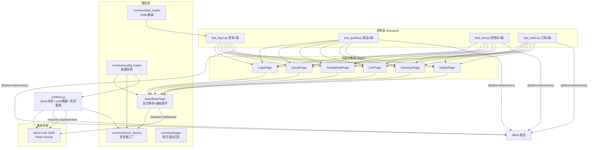

# ui-test-framework — demo-mall Web UI 自动化测试框架

> 基于 **PO 三层架构 + 显式等待 + 失败自动截图 + Allure 报告** 的 Web UI 自动化测试框架，
> 被测系统为本地商城 [demo-mall](../demo-mall)（Flask + SQLite 服务端渲染）。
> 项目定位：**简历级参考实现**——面试能讲清每一层"为什么这样设计"，复现能照文档一步步跑通。

## 一、它解决什么问题

手工回归一个商城的核心链路（登录 → 搜索 → 加购 → 下单 → 支付）至少 5 分钟，且漏测、疲劳误判不可避免。
本框架把 22 条用例固化为代码，**一条命令 80 秒跑完并输出可视化报告**，失败自动留截图现场，数据自动还原保证随时可重跑。

## 二、架构总图



**三层职责一句话**：用例层只写"做什么 + 断言什么"；页面对象层只写"元素怎么定位、页面怎么操作"；基础层把"怎么等、怎么起浏览器、怎么读配置"收口成基础设施。

## 三、三步快速启动

```bash
# 0. 环境：Python 3.13，Chrome 已装（驱动由 Selenium Manager 自动下载）
cd ui-test-framework
pip install -r requirements.txt

# 1. 启动被测系统（另开一个终端；默认端口 5000）
cd ../demo-mall && python run.py

# 2. 跑测试（结果自动写入 reports/allure-results，失败自动截图到 screenshots/）
cd ../ui-test-framework
python -m pytest -v
# 期望输出最后一行：22 passed in ~80s

# 3. 出 Allure 报告（allure 命令行 2.x 需单独安装）
allure generate reports/allure-results -o reports/allure-report --clean
allure open reports/allure-report
```

临时换端口不改配置：`UI_TEST_BASE_URL=http://127.0.0.1:5001 python -m pytest -v`
CI/无人值守加无头：`UI_TEST_HEADLESS=1 python -m pytest -v`

## 四、目录说明

```
ui-test-framework/
├── README.md                  # 本文件
├── requirements.txt           # 依赖清单（含版本）
├── pytest.ini                 # pytest 配置：alluredir / 失败重跑 / smoke 标记
├── .gitignore                 # reports/ screenshots/ logs/ 等运行产物不进库
├── config/
│   └── config.yaml            # 全局配置：base_url / browser / headless / timeout / test_key
├── common/                    # 公共基础设施层
│   ├── config_loader.py       # 配置单例 + 环境变量覆盖（UI_TEST_BASE_URL / UI_TEST_HEADLESS）
│   ├── logger.py              # 按天滚动文件日志 + 控制台
│   ├── driver_factory.py      # create_driver()：chrome/edge、无头开关、唯一建 WebDriver 的地方
│   └── data_loader.py         # load_yaml()：测试数据统一入口
├── base/
│   └── base_page.py           # BasePage：WebDriverWait 显式等待封装 + 基础操作 + flash/导航栏
├── pages/                     # 页面对象层（只放定位器 + 页面动作，禁止断言）
│   ├── login_page.py          # 登录页
│   ├── goods_page.py          # 商品列表（搜索/行数据/行级加购/进详情）
│   ├── goods_detail_page.py   # 商品详情（读信息/设数量/加购）
│   ├── cart_page.py           # 购物车（行数/总价/改数量/删除/去结算）
│   ├── checkout_page.py       # 结算页（总价/提交订单）
│   └── orders_page.py         # 订单页（状态/支付/取消）
├── data/
│   └── users.yaml             # 登录账号数据驱动（有效账号 + 3 组失败场景）
├── testcases/                 # 用例层（断言只在这里）
│   ├── conftest.py            # driver 夹具 / 会话级数据 reset / 失败自动截图钩子
│   ├── test_login.py          # 登录模块 7 条
│   ├── test_goods.py          # 商品模块 6 条
│   ├── test_cart.py           # 购物车模块 4 条
│   └── test_order.py          # 订单模块 5 条
├── screenshots/               # 失败截图（运行产物，gitignore）
├── reports/                   # allure-results 原始结果 + allure-report 静态报告（gitignore）
└── docs/                      # ★ 逐模块教学文档（复现请从 00 开始读）
```

## 五、用例清单（22 条）

| 模块 | 用例 | 验证点 | 标记 |
|---|---|---|---|
| 登录 | test_login_success | lemon 登录成功跳 /goods，导航栏"你好，柠檬" | smoke |
| 登录 | test_login_success_second_account | 第二账号 test 也能登录 | |
| 登录 | test_login_failed_data_driven[密码错误] | flash"用户名或密码错误" | |
| 登录 | test_login_failed_data_driven[用户不存在] | 同上（YAML 数据驱动） | |
| 登录 | test_login_failed_data_driven[空用户名] | 同上 | |
| 登录 | test_logout | 退出回登录页，"已退出登录"，登录入口重现 | |
| 登录 | test_cart_requires_login | 未登录访问 /cart 被 302 到 /login，flash"请先登录" | |
| 商品 | test_default_list_has_10_rows | 默认列表 10 行 | smoke |
| 商品 | test_search_hit_one_row | 搜"耳机"命中 1 行且名称正确 | |
| 商品 | test_search_no_result_shows_empty_tip | 无结果出现 #empty-result | |
| 商品 | test_open_detail_from_list | 进详情断言名称/价格/库存 | |
| 商品 | test_add_to_cart_from_detail | 详情页设数量加购，flash"已加入购物车" | |
| 商品 | test_add_to_cart_from_list_row | 列表行级加购，flash"已加入购物车" | |
| 购物车 | test_cart_rows_and_total | 2 行、合计 1498.00、小计正确 | smoke |
| 购物车 | test_update_quantity_changes_total | 数量 1→3，合计变 597.00 | |
| 购物车 | test_delete_item_decreases_rows | 删除后行数 2→1，合计只剩另一件 | |
| 购物车 | test_empty_cart_shows_empty_tip | 空车提示"空空如也"、无"去结算"入口 | |
| 订单 | test_e2e_create_order_pending | 搜索→详情→加购→结算→下单，pending + ORD 单号 | smoke |
| 订单 | test_orders_requires_login | 未登录访问 /orders 跳登录 | |
| 订单 | test_pay_pending_order | 支付后状态变 paid（文本+样式类双断言） | |
| 订单 | test_paid_order_cannot_cancel | paid 后取消按钮消失（状态机 UI 规则） | |
| 订单 | test_cancel_pending_order_restores_stock | 取消后变 cancelled，库存回滚 49→50 | |

## 六、教学文档索引

复现请按顺序阅读（每篇都含"怎么实现/为什么这样设计/怎么验证/常见坑/面试怎么讲/复现任务清单"八节）：

| 文档 | 内容 | 对应代码 |
|---|---|---|
| [00-项目总览](docs/00-项目总览.md) | 定位、架构、学习路线配合 | 全局 |
| [01-工程结构与PO分层设计](docs/01-工程结构与PO分层设计.md) | 三层职责、目录组织 | 目录结构 |
| [02-driver工厂与浏览器管理](docs/02-driver工厂与浏览器管理.md) | Selenium Manager、无头模式、参数 | common/driver_factory.py |
| [03-BasePage封装与显式等待](docs/03-BasePage封装与显式等待.md) | WebDriverWait 机制、三种等待对比 | base/base_page.py |
| [04-页面对象层与元素定位](docs/04-页面对象层与元素定位.md) | 6 个 Page 类、定位器选型 | pages/ |
| [05-用例层conftest与fixture](docs/05-用例层conftest与fixture.md) | 夹具体系、数据 reset、AAA 结构 | testcases/conftest.py、test_*.py |
| [06-失败截图与稳定性工程](docs/06-失败截图与稳定性工程.md) | makereport 钩子、重跑、同步陷阱 | conftest.py、pytest.ini |
| [07-数据驱动与Allure报告](docs/07-数据驱动与Allure报告.md) | YAML 数据驱动、Allure 体系 | data/users.yaml、pytest.ini |

## 七、设计底线（面试常问，先给结论）

1. **全项目零 `time.sleep`**——所有等待都是 `WebDriverWait` 显式等待（详见 docs/03）；
2. **PO 层零断言、用例层零定位器**——谁改页面改一处，谁改断言改一处；
3. **唯一建 WebDriver 的地方在 driver_factory**——其余代码只能"要"不能"造"；
4. **数据可重复**——会话开始 + 关键用例前都调 `/api/test/reset`，连跑 N 次结果一致；
5. **失败必有现场**——call 阶段失败自动截图（本地文件 + Allure 附件双落点）。
