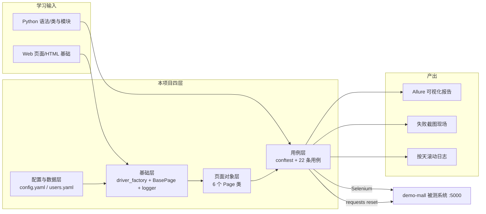

# 项目总览（ui-test-framework · 文档00）

> 一句话：这套项目解决"如何把手工回归固化成 80 秒跑完、失败自带现场、数据永远可重跑的自动化资产"，并把每一层的设计决策讲透，让你既能复现又能面试讲清为什么。

## 1. 在整个框架中的位置

本文档是全部 8 篇教学文档的入口：先建立全局地图，再逐模块深入。



上下游关系：
- **被测系统 demo-mall**（上游输入）：它埋好了稳定 id（`#username`、`#btn-login`…）和统一 flash 提示，这是 UI 自动化"定位器稳定"的前提——没有这个约定，任何框架都救不了。
- **配置/数据层**（支撑）：base_url、账号、钥匙全部外置，代码里不出现魔法值。
- **基础层**（支撑）：等待、日志、浏览器创建收口成公共设施，上层只调用不重复造。
- **报告体系**（下游产出）：pytest 结果 → allure-results JSON → Allure 静态报告；失败用例额外产出截图。

## 2. 涉及文件

| 文件 | 职责 |
|---|---|
| `README.md` | 项目门面：架构图、快速启动、22 条用例清单 |
| `config/config.yaml` | 全局配置单例的数据源 |
| `data/users.yaml` | 登录数据驱动文件 |
| `common/` 4 个模块 | 配置加载 / 日志 / 浏览器工厂 / YAML 数据 |
| `base/base_page.py` | 显式等待 + 基础操作封装 |
| `pages/` 6 个类 | 每个页面的定位器与动作 |
| `testcases/` conftest + 4 文件 | 夹具基础设施 + 22 条用例 |
| `docs/00~07` | 本系列教学文档 |

## 3. 如何实现（总体工作流）

框架的"实现"本质上是一条流水线，跑一条用例时发生了什么：

1. **pytest 启动**：读 `pytest.ini` → 收集 `testcases/` 下 `test_*.py`；
2. **会话级夹具**（conftest `_mall_ready_and_reset`）：requests 探活 demo-mall → POST `/api/test/reset` 把数据库还原成种子态；
3. **用例级夹具**（`driver`）：调 `driver_factory.create_driver()` 起一个全新 Chrome；
4. **用例体**：实例化 Page 对象 → 调页面动作（每个动作内部用 WebDriverWait 同步）→ assert 断言；
5. **结果处理**：通过 → 写 allure-results；失败 → `pytest_runtest_makereport` 钩子截图并 attach → `--reruns 1` 自动重跑一次；
6. **清理**：driver fixture `yield` 之后 `quit()`；
7. **出报告**：`allure generate` 把 JSON 渲染成静态站点。

用例总数 22 条（≥14 达标）：登录 7 + 商品 6 + 购物车 4 + 订单 5，其中 4 条挂 `@pytest.mark.smoke` 冒烟标记。

## 4. 为什么这样设计（决策点 + 备选方案对比表）

| 决策 | 备选方案 | 对比结论 |
|---|---|---|
| Selenium + pytest | Playwright / Cypress | Playwright 自动等待更强、更现代；但**面试市场与存量岗位 Selenium 占绝对多数**，且 Playwright 的自动等待会让你学不到"等待原理"。选 Selenium 并亲手实现显式等待，是"理解深度优先"的选择 |
| 服务端渲染被测系统（demo-mall） | 自己找 Vue/React 单页应用练手 | SPA 元素动态渲染，新手第一步就会死在等待上；服务端渲染让"页面何时就绪"边界清晰，适合先建立正确的同步观，再挑战 SPA |
| 自建轻量框架 | 直接上 Pytest+PO 现成脚手架（如 pytest-base-ui 类） | 脚手架把所有设计决策藏起来了，面试一问"为什么这么封装"就露馅。自建 8 个文件、几百行代码，每个决策都是自己的 |
| 会话级 + 用例级两级数据 reset | 用例自己清理数据 / 每条用例都 reset | 用例自清理越写越乱（删失败残留一半）；每条都 reset 浪费时间。两级 reset：会话级保"跨运行可重复"，用例级只给强数据假设的用例（购物车/订单） |
| Chrome 一个浏览器打样 | 多浏览器矩阵 | 新手阶段"一个浏览器跑稳"价值远大于"三个浏览器都半残"；driver_factory 里 chrome/edge 可切换，矩阵只差一个参数化 |

## 5. 怎么运行/验证

```bash
# 终端1：起被测系统（标准端口 5000）
cd /d/软件测试/demo-mall && python run.py

# 终端2：跑测试（真实运行输出，Python 3.13 + Chrome 无头）
cd /d/软件测试/ui-test-framework
python -m pytest -v
# ======================== 22 passed in 79.44s (0:01:19) ========================

# 连续第二次跑（验证数据 reset 带来的可重复性）
python -m pytest -v
# ======================== 22 passed in 78.17s (0:01:18) ========================

# 出报告
allure generate reports/allure-results -o reports/allure-report --clean
# Report successfully generated to reports\allure-report
```

注意上面输出是**真实连续两次运行**的结果：第二次没有做任何人工清理，靠的就是 `/api/test/reset`。

## 6. 常见坑

1. **端口冲突**：5000 被别的进程占了，`python run.py` 直接报 `Address already in use`。解决：`python run.py --port 5001` 起新实例，测试侧用环境变量 `UI_TEST_BASE_URL=http://127.0.0.1:5001` 覆盖，**不要改 config.yaml**。
2. **以为跑通了其实在测旧数据**：第一次跑失败留下脏数据（比如购物车里多了一件商品），第二次跑"莫名其妙"挂掉——所有强数据假设的用例必须显式 reset，不能靠"我记得我上次删干净了"。
3. **文档/代码两张皮**：很多人代码抄完就过，面试被问"为什么显式等待不用隐式等待"答不上。对策：每篇文档的"面试怎么讲"一节都要真的开口练。

## 7. 面试怎么讲

**30 秒版本**：
"我针对一个 Flask 商城自建了 PO 三层的 UI 自动化框架：基础层封装显式等待和浏览器工厂，页面对象层 6 个类只放定位器和动作，用例层 22 条覆盖登录/商品/购物车/订单全链路。数据上用被测系统的 reset 接口保证可重复，稳定性上全项目零 sleep、失败自动截图进 Allure 报告，两次连跑都是 22 条全绿。"

**3 个高频追问及答法**：
1. *"UI 自动化这么慢这么脆，价值在哪？"* —— 价值在"回归"：核心链路手工回归 5 分钟且必漏测，自动化 80 秒覆盖 22 个检查点；脆的根源是同步没做好，我用显式等待+统一 flash 同步点把 flaky 压到可忽略（可举实测连跑全绿的数据）。
2. *"AI 都能写测试用例了，这套东西还有含金量吗？"* —— AI 能生成用例文本，但"框架如何保证用例稳定可重复、失败如何定位、数据如何还原"是工程决策，AI 生成的代码只有懂 WebDriverWait 轮询机制、PO 边界的人才敢上线。我这套项目的价值就是把这些决策显式化。
3. *"怎么接入 CI？"* —— pytest.ini 已带 alluredir 和 reruns；CI 上加两个环境变量即可：`UI_TEST_HEADLESS=1` 无头、`UI_TEST_BASE_URL` 指向部署好的测试环境；allure-results 作为产物上传，用 Allure 服务端或 GitHub Pages 展示趋势。

## 8. 复现任务清单

按序动手，每步有验收标准：

1. **跑通被测系统**：`cd demo-mall && python run.py`，浏览器打开 `http://127.0.0.1:5000/goods` 能看到 10 件商品；`curl -X POST http://127.0.0.1:5000/api/test/reset -H "X-Test-Key: mall-test-key"` 返回 `{"code":0,...}`。
2. **建工程骨架**：按 README 目录结构建目录和空文件（含每个包的 `__init__.py`），`python -c "import common, base, pages, testcases"` 不报错。
3. **写配置层**：config.yaml + config_loader.py，验收：`python -c "from common.config_loader import config; print(config['base_url'])"` 打印 5000 地址；设 `UI_TEST_BASE_URL` 后再打印变为新地址。
4. **写日志与数据加载**：logger.py、data_loader.py，验收：import 时 `logs/ui_test.log` 出现，`load_yaml("data/users.yaml")` 能读到 lemon。
5. **写浏览器工厂**：验收：`create_driver()` 能弹出 Chrome 并打开空白页，headless 改 true 后不再弹窗。
6. **写 BasePage**：验收：写一条 3 行的临时脚本，用 BasePage 打开 /login 并读出 `#btn-login` 文本"登 录"。
7. **写 6 个 Page 类**：验收：`python -m pyflakes pages/`（或直接 import）无错误，类里没有 assert。
8. **写 conftest 与第一批用例**：先写 test_login.py 7 条，验收：`pytest testcases/test_login.py -v` 7 passed。
9. **补齐商品/购物车/订单用例**：验收：全量 `pytest -v` 22 passed。
10. **验证可重复**：连跑两次全绿；故意改坏一个定位器跑一次，确认 screenshots/ 出现截图、Allure 报告里能看到失败现场（看完改回来）。
11. **接入 Allure**：`allure generate` 后 `allure open`，验收：报告里 22 条用例、feature/story 分组正确。
12. **git 收尾**：`git init && git add -A && git commit`，验收：`git status` 干净，reports/screenshots/logs 没进库。
