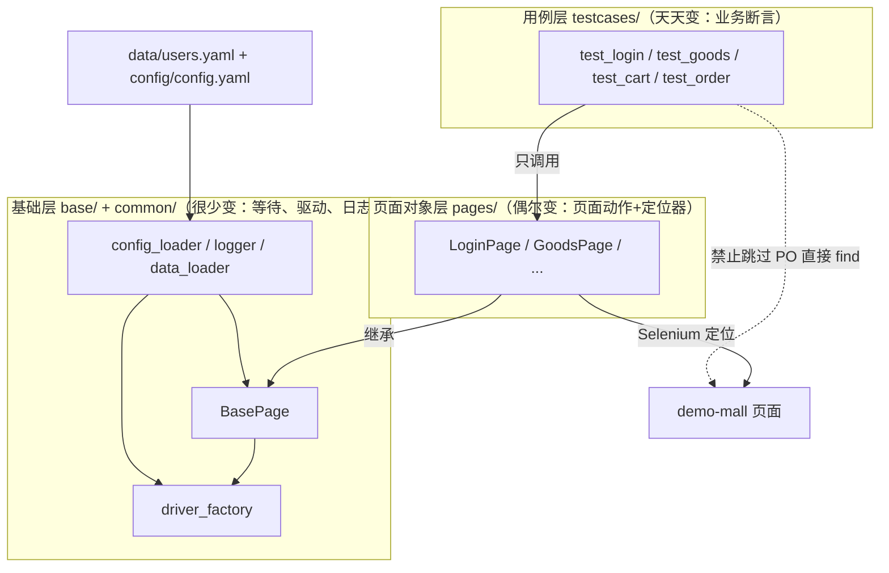

# 工程结构与PO分层设计（ui-test-framework · 文档01）

> 一句话：解决"代码放哪、谁依赖谁、页面变了改哪里"的结构问题——用目录边界和 PO 分层把"定位器、页面动作、业务断言"三样天天变的东西隔离进各自的层。

## 1. 在整个框架中的位置

分层是框架的地基：本文档定义的边界决定后面每一篇文档里代码"住在哪一层"。



依赖规则（单向、不可逆）：
- 用例层 → 页面对象层 → 基础层；**下层永远不知道上层的存在**（BasePage 里没有任何业务词）；
- 用例层**禁止**直接 `driver.find_element`——所有元素交互必须经 Page 类；
- 页面对象层**禁止** assert——断言是用例层的语言。

## 2. 涉及文件

| 文件 | 职责 |
|---|---|
| `config/` `common/` `base/` `pages/` `testcases/` `data/` | 六个目录各自只装一类东西 |
| 每个含代码目录的 `__init__.py` | 把目录声明为 Python 包，使 `from pages.login_page import LoginPage` 这种绝对导入成立 |
| `pytest.ini` | 收集范围（testpaths=testcases）与默认参数 |
| `.gitignore` | 运行产物（reports/screenshots/logs）不进版本库 |
| `requirements.txt` | 依赖版本固定，别人 `pip install -r` 即可复现环境 |

## 3. 如何实现（逐层讲解）

### 3.1 为什么"每个目录都要 `__init__.py`"

Python 3 支持没有 `__init__.py` 的"命名空间包"，但显式声明有两个实际好处：
1. `pytest` 的根目录推导与导入更可预期——当 `pytest.ini` 存在时 pytest 以它所在目录为 rootdir，配合 `__init__.py`，`testcases/test_login.py` 的模块名是 `testcases.test_login`，不同目录下的同名测试文件不会冲突（没有 `__init__.py` 时两个 `test_login.py` 会撞名报 import 错）；
2. 明确表达"这是包不是杂物间"，IDE 跳转、重构也更可靠。

### 3.2 三层各自的"词汇表"

判断一段代码放哪层的实用标准——看它用什么词说话：

- **基础层词汇**：`find`、`click`、`wait`、`driver`、`locator`。看 `base/base_page.py` 的方法签名，没有一个"登录/购物车"这类业务词：

```python
class BasePage:
    def find(self, locator):
        return self.wait.until(EC.visibility_of_element_located(locator))

    def click(self, locator):
        self.find_clickable(locator).click()
```

- **页面对象层词汇**：`login`、`search`、`add_to_cart`——业务动作 + 定位器常量，无断言：

```python
class LoginPage(BasePage):
    USERNAME_INPUT = (By.ID, "username")      # 定位器：类常量
    LOGIN_BUTTON = (By.ID, "btn-login")

    def login(self, username: str, password: str):
        self.input(self.USERNAME_INPUT, username)
        self.input(self.PASSWORD_INPUT, password)
        self.click(self.LOGIN_BUTTON)
```

- **用例层词汇**：`assert`、`pytest.mark`、`allure`——只表达"操作序列 + 预期"：

```python
def test_login_success(self, driver):
    page = LoginPage(driver).open_login_page()
    page.login_and_expect_success("lemon", "123456")
    assert "/goods" in driver.current_url
    assert GoodsPage(driver).nav_user_text() == "你好，柠檬"
```

### 3.3 页面对象之间的"交接"

多页面的链路（列表→详情→购物车→结算→订单）里，一个页面动作的落点在下一个页面，返回下一个页面对象让用例读起来像业务流程：

```python
# pages/cart_page.py
def checkout(self):
    self.click(self.CHECKOUT_LINK)
    from pages.checkout_page import CheckoutPage   # 方法内延迟导入，避免模块循环依赖
    page = CheckoutPage(self.driver)
    page.wait_ready()                              # 交接前先等新页面就绪
    return page
```

用例侧于是变成流水账：`orders = cart.checkout().submit_order()`。

### 3.4 导航栏为什么放在 BasePage

`#nav-user`、`#btn-logout`、`#flash` 定义在 `base.html`（所有页面共享的模板），不属于任何一页。把它们收进 BasePage（`nav_user_text()`、`logout()`、`wait_flash_contains()`），避免"每个 Page 类都抄一遍同样的定位器"。

### 3.5 运行产物与源码隔离

`screenshots/`、`reports/`、`logs/` 都是**运行时产生**的，`.gitignore` 全部挡掉（`!screenshots/.gitkeep` 保留空目录占位）。仓库里只进"可复现的源"——clone 下来就是干净的。

## 4. 为什么这样设计（决策点 + 备选方案对比表）

| 决策 | 备选方案 | 对比结论 |
|---|---|---|
| 经典三层 PO | 纯脚本（一条用例从头写到尾） | 纯脚本写第一个用例快 3 倍，写第 10 个用例时定位器已经抄了 20 遍；页面一改版 30 处要改。PO 把定位器收敛到一处，改版只动 pages/ |
| PO 层禁止断言 | PO 方法里顺手 assert（如 `login()` 内部断言跳转） | PO 混入断言后无法复用：同一页面"登录成功/失败"两种预期就没法用一个 `login()`。PO 只做动作、返回状态，预期由用例表达 |
| 定位器写成类常量 | 写在方法里现用现写 | 常量集中在类头部，页面改版时"打开一个文件、眼睛扫一遍"即可完成修复；方法内定位器散落各处不可审计 |
| BasePage 承载共享导航/flash | 每页自己实现 / 再抽一个 NavBar 组件类 | 单页面应用可以用组件类（Page Object + Component Object 模式），但本项目导航栏在服务端模板里全局唯一，抽组件类是过度设计；BasePage 承载是"够用且最简单"的解 |
| 按页面拆文件（每页一个类） | 按功能拆（如 login_flow.py 串多页） | 页面是相对稳定的映射单位（页面没了类才删），功能流会跨页漂移；pytest 按功能组织用例文件（test_cart.py），两边天然对齐 |
| 目录用中文名（如 用例/） | 英文目录名 | 工具链（pytest、allure、CI 脚本）对非 ASCII 路径偶有兼容问题；代码内注释、docstring 全中文，兼顾可读性与兼容性 |

## 5. 怎么运行/验证

分层是否真的成立，用两条命令验证：

```bash
# 1) 用例层没有任何定位器硬编码（搜不到 By.）
grep -rn "By\." testcases/test_*.py
# 真实结果：无输出，exit=1（定位器全部在 pages/ 与 base/）

# 2) 页面对象层没有任何断言代码
grep -rn "assert" pages/ base/ common/
# 真实结果：唯一命中是 login_page.py 顶部 docstring 里"不含任何 assert"这句
# 纪律说明文字（中文注释），没有任何 assert 语句
```

再跑一遍全量确认结构没被破坏：

```bash
python -m pytest -v
# ======================== 22 passed in 79.44s (0:01:19) ========================
```

## 6. 常见坑

1. **用例之间共享一个 Page 实例导致状态串台**：把 `GoodsPage` 建成模块级单例复用，结果前一条用例把浏览器关了，后一条用例拿着旧 driver 直接 `NoSuchWindowException`。Page 对象是"页面在当前 driver 里的视图"，必须随 driver 一起在用例内创建。
2. **Page 类互相 import 造成循环依赖**：`cart_page.py` 顶部 import `checkout_page`，而 checkout 的提交又回到 orders，链一长就环。对策：页面对象"交接"用的 import 放在**方法内部**（延迟导入），Python 每次调用才解析，天然断环。
3. **`__init__.py` 忘了建，pytest 收集时同名文件报错**：`testcases/test_login.py` 与将来练习目录 `practice/test_login.py` 同时存在且都没有包声明，报 `import file mismatch`。建全 `__init__.py` 即解。
4. **把"页面元素"写进用例层**：图省事在用例里 `driver.find_element(By.ID, "cart-total")`，页面一改版用例层照样要修，PO 白分了。纪律：用例层出现 `By.` 就是代码评审必拦的问题。

## 7. 面试怎么讲

**30 秒版本**：
"我用经典三层 PO：用例层只写业务动作序列和断言，页面对象层只放定位器和页面动作，基础层封装显式等待和浏览器工厂，依赖严格单向。验证分层是否落地的标准很硬：用例层 grep 不到 By.，pages 目录 grep 不到 assert。页面改版只改 pages 一层，22 条用例其他代码零改动。"

**3 个高频追问及答法**：
1. *"PO 的粒度怎么把握？一个页面一定要一个类吗？"* —— 粒度跟着"维护成本"走：demo-mall 每页元素少，一页一类；复杂页面（多 Tab、多组件）会再拆 Component Object（如导航栏、分页器组件），PO 表达"页面"，组件表达"页面上的可复用区块"。
2. *"PO 里的动作方法该返回什么？"* —— 三种：无返回（纯动作如 logout）、状态值（get_text/row_count 供断言）、下一个页面对象（动作引起跳转时，如 checkout() 返回 CheckoutPage）。原则：返回值要"类型明确、可链式"，绝不返回 WebElement 让用例层去操作元素（那等于把 PO 击穿了）。
3. *"BasePage 和 utils 有什么区别？为什么不用一个 utils.py 塞所有公共函数？"* —— BasePage 是"每个页面对象的公共父类"，有继承语义（self.driver、self.wait 是页面上下文）；utils 是无状态函数集。把"读配置"这种无上下文的事放 utils/common，把"与页面相关"的事放 BasePage，混在一起早晚长成千行大杂烩。

## 8. 复现任务清单

1. **建目录树**：按 README 结构建 6 个代码/数据目录 + 每个代码目录的 `__init__.py`。验收：`python -c "import common, base, pages, testcases"` 无报错。
2. **写 pytest.ini 与 .gitignore**：验收：`python -m pytest --collect-only` 只收集 testcases/ 下文件。
3. **建立"分层纪律"检查习惯**：写一个自己的检查命令（grep 两条，见第 5 节），以后每写完一批代码跑一次。验收：两条 grep 均无输出。
4. **先写 LoginPage 走通三层**：BasePage 骨架 + LoginPage + 一条登录成功用例。验收：`pytest testcases/test_login.py::TestLogin::test_login_success -v` 单条通过。
5. **故意破坏分层观察后果**：把 `login()` 里加上 assert（模拟新手错误），体会"断言进了 PO 后，登录失败用例必须另写一个方法"的别扭；然后删掉，恢复纪律。验收：能口头说出"为什么 PO 禁断言"。
6. **完成剩余 Page 类与用例文件**：验收：全量 `pytest -v` 22 passed，且 grep 检查依然干净。
