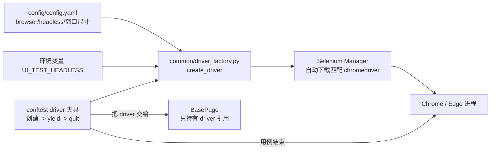

# driver工厂与浏览器管理（ui-test-framework · 文档02）

> 一句话：解决"浏览器从哪来、参数谁说了算、驱动版本谁维护"的问题——把 WebDriver 的创建收口到唯一工厂，做到换浏览器/换环境/上 CI 只改配置不改代码。

## 1. 在整个框架中的位置

driver_factory 是基础层里"最靠前"的一环：没有 driver 实例，BasePage、Page、用例全都无从谈起。



依赖关系：
- **上游**：config_loader（读 browser/headless/尺寸，含环境变量覆盖）；
- **下游**：只有 conftest 的 `driver` 夹具调用 `create_driver()`——全项目**唯一调用点**；其余代码只经夹具拿现成实例。

## 2. 涉及文件

| 文件 | 职责 |
|---|---|
| `common/driver_factory.py` | `_build_options()` 构造启动选项；`create_driver()` 创建就绪的 WebDriver |
| `common/config_loader.py` | 提供 browser/headless/window_width/window_height 配置（含环境变量覆盖） |
| `testcases/conftest.py` | `driver` 夹具：调用工厂、yield 后 `quit()`——生命周期管理者 |
| `config/config.yaml` | browser: chrome / headless: false / window 1440x900 等默认值 |

## 3. 如何实现（逐方法讲解）

### 3.1 `_build_options(browser, headless)` —— 启动参数集中地

```python
def _build_options(browser: str, headless: bool):
    if browser == "chrome":
        options = webdriver.ChromeOptions()
    elif browser == "edge":
        options = webdriver.EdgeOptions()
    else:
        raise ValueError(f"不支持的浏览器类型：{browser}（仅支持 chrome/edge）")

    options.add_argument(f"--window-size={config['window_width']},{config['window_height']}")
    options.add_argument("--disable-gpu")          # Windows 无头模式下 Chrome 需要禁 GPU 才稳定
    options.add_argument("--disable-infobars")     # 关掉"受自动化控制"提示条，避免遮挡
    options.add_argument("--no-first-run")
    options.add_argument("--disable-extensions")

    if headless:
        options.add_argument("--headless=new")
    return options
```

逐参数讲机制：
- `--window-size`：无头模式没有真实屏幕，**必须**显式给尺寸，否则默认 800x600，很多元素直接跑出视口，`visibility_of_element_located` 判"不可见"而超时——这是"本地能跑、CI 全挂"的头号原因；
- `--headless=new`：Chrome 109+ 的新无头模式，与有头浏览器共用真实渲染管线；旧的 `--headless` 是另一套简化内核，行为差异会导致"无头下才出现的 bug"；
- `--disable-gpu`：Windows 上老渲染路径的已知稳定性问题，无头下基本必加。

### 3.2 `create_driver()` —— 创建 + 策略声明

```python
def create_driver() -> webdriver.Chrome:
    browser = str(config.get("browser", "chrome")).lower()
    headless = bool(config.get("headless", False))
    logger.info("创建浏览器：browser=%s headless=%s", browser, headless)

    options = _build_options(browser, headless)
    if browser == "chrome":
        driver = webdriver.Chrome(options=options)   # 不传 Service！
    else:
        driver = webdriver.Edge(options=options)

    driver.implicitly_wait(0)   # 显式声明：本框架 100% 依赖显式等待
    return driver
```

**`webdriver.Chrome(options=options)` 背后发生了什么**（面试高频）：
Selenium 4.6 起内置 **Selenium Manager**：当没传 `Service(executable_path=...)` 时，它检测本机 Chrome 版本（读注册表/常见安装路径），去 Google 的驱动仓库下载**匹配大版本**的 chromedriver，缓存到 `~/.cache/selenium/`，再把启动参数通过本地驱动进程转发给浏览器。Chrome 升级后第一次跑会自动重新匹配，**不再需要手工对版本、也不需要 webdriver_manager 第三方库**。

**为什么 `implicitly_wait(0)`**：隐式等待默认本来就是 0，这里显式置 0 是**策略声明**——本框架的等待哲学是"每个操作声明自己的成功条件"（显式等待），不允许隐式/显式混用（混用的轮询叠加行为见文档 03）。

### 3.3 `driver` 夹具 —— 谁生谁灭的另一半

```python
@pytest.fixture()
def driver():
    d = create_driver()
    logger.info("浏览器会话已创建")
    yield d
    d.quit()
```

工厂管"生"（怎么建），夹具管"死"（何时退）。`quit()` 与 `close()` 的区别必须分清：`close()` 只关当前窗口，chromedriver 进程还挂着——连续跑 22 条用例就攒 22 个僵尸进程；`quit()` 释放整个会话并结束驱动进程。

## 4. 为什么这样设计（决策点 + 备选方案对比表）

| 决策 | 备选方案 | 对比结论 |
|---|---|---|
| 工厂函数统一创建 | 各用例自己 `webdriver.Chrome()` | 分散创建 = 参数各自为政、驱动管理无从谈起；收口后"换浏览器"是一行配置 |
| Selenium Manager 管驱动 | 手工下载 chromedriver 配 path / webdriver_manager 库 | 手工方案每次 Chrome 升级全员翻车（版本不匹配报 SessionNotCreated）；webdriver_manager 是 Manager 出现前的过渡品；Manager 内置、零依赖、自动缓存 |
| function 级 driver 夹具（每用例一个新浏览器） | session 级共享一个浏览器 | 共享浏览器快 30%~40%，但 cookie/session/购物车状态跨用例残留，一条失败连环挂；隔离换来的排查成本优势远大于几十秒运行时间 |
| headless 由配置+环境变量控制 | 写死 headless | 本地调试要看浏览器动作（false），CI 必须 true（没有显示器）；一个环境变量解决，不改文件 |
| 每用例全新 profile（默认行为） | 复用固定 user-data-dir | 固定 profile 会带上历史 cookie/缓存，测试结果不可预期；自动化要的是"每次都是干净的第一访客" |

## 5. 怎么运行/验证

```bash
# 1) 冒烟验证工厂：3 行脚本起浏览器、开登录页、读按钮文本
cd /d/软件测试/ui-test-framework
UI_TEST_BASE_URL=http://127.0.0.1:5001 UI_TEST_HEADLESS=1 python -c "
from common.driver_factory import create_driver
from common.config_loader import config
d = create_driver()
d.get(config['base_url'] + '/login')
print('login page OK, title =', d.title, '| btn text =', d.find_element('id', 'btn-login').text)
d.quit()
"
# 真实输出：
# 2026-10-25 05:20:25 [INFO] ui_test: 创建浏览器：browser=chrome headless=True
# login page OK, title = 登录 - Demo Mall | btn text = 登 录

# 2) 无头开关验证：把 UI_TEST_HEADLESS 去掉再跑，屏幕上应弹出 Chrome 窗口一闪而过
UI_TEST_BASE_URL=http://127.0.0.1:5001 python -c "from common.driver_factory import create_driver; create_driver().quit()"

# 3) 全量用例验证（真实输出）
python -m pytest -v
# ======================== 22 passed in 79.44s (0:01:19) ========================
```

驱动缓存放哪了（验证 Selenium Manager 生效）：`ls ~/.cache/selenium/` 能看到 chromedriver 目录，第二次起浏览器明显变快（不再下载）。

## 6. 常见坑

1. **`SessionNotCreatedException: This version of ChromeDriver only supports Chrome version XX`**：手工管理驱动时代的经典报错。本项目用 Selenium Manager 不会出现；如果 cloned 别人的老项目遇到，解法就是删掉硬编码的 executable_path 换成 `webdriver.Chrome(options=...)`。
2. **无头模式元素"不可见"超时**：headless 下没设 `--window-size`，视口 800x600，页面下方元素被判不可见。现象是"有头能过、无头必挂"。对策已内置：工厂里无条件加 window-size。
3. **Chrome 启动即闪退 / first run 向导卡住**：某些机器首次启动会弹"设置为默认浏览器"等系统级弹窗挡住自动化。对策：工厂里已加 `--no-first-run`、`--disable-infobars`；若仍出现，加 `user-data-dir` 指到临时目录。
4. **僵尸 chromedriver 进程**：调试时 Ctrl+C 打断 pytest，yield 后的 `quit()` 没执行，任务管理器里 chromedriver 越积越多，最后"端口/会话异常"。对策：用 `quit()` 不用 `close()`；打断后 `taskkill /IM chromedriver.exe /F` 清理。
5. **Edge 用户注意**：`webdriver.Edge(options=...)` 同样走 Selenium Manager（下载 msedgedriver），但 Windows 上 Edge 升级策略不同，偶发需要手动匹配——换浏览器后先单跑一条冒烟用例再上全量。

## 7. 面试怎么讲

**30 秒版本**：
"浏览器创建收口在一个工厂函数：按 config.yaml 的 browser/headless 构造 ChromeOptions，无头模式显式设 window-size 避免 CI 视口坑；驱动由 Selenium 4.6+ 的 Selenium Manager 按本机 Chrome 版本自动下载缓存，不手工维护。生命周期交给 pytest 的 function 级夹具——每条用例全新浏览器、yield 后 quit，隔离又防僵尸进程。全项目只有夹具一个地方调用工厂。"

**3 个高频追问及答法**：
1. *"为什么每条用例都开一个新浏览器，不共享？"* —— 测试隔离：cookie、session、购物车都是浏览器会话状态，共享会把"用例间依赖"藏进运行时，失败排查变成玄学。实测全量 22 条也就 80 秒，隔离成本可接受；真要提速，先上并行（pytest-xdist 按进程隔离）而不是共享浏览器。
2. *"Selenium Manager 原理？离线环境怎么办？"* —— 它读浏览器安装信息拿到版本号，从官方源下载匹配驱动缓存到 ~/.cache/selenium。离线环境：预先在有网机器上把对应版本 chromedriver 下好，用 `Service(executable_path=...)` 显式指定，或提前把缓存目录带过去。
3. *"如何支持多浏览器矩阵？"* —— driver_factory 已支持 chrome/edge 切换；矩阵化只需夹具参数化：`@pytest.fixture(params=["chrome","edge"])`，每个参数一个 driver 实例，用例零改动。真正的成本在兼容性用例维护，不在框架。

## 8. 复现任务清单

1. **装依赖并确认版本**：`pip install -r requirements.txt`。验收：`python -c "import selenium; print(selenium.__version__)"` 输出 4.51.0（或更高 4.x）。
2. **写 driver_factory 骨架**：先只支持 chrome 有头。验收：`create_driver()` 弹出 1440x900 的 Chrome 窗口。
3. **接入配置**：browser/headless/窗口尺寸全部来自 config.yaml。验收：改配置文件里的 browser 为 edge 能起 Edge（改回 chrome）。
4. **验证环境变量覆盖**：`UI_TEST_HEADLESS=1` 起浏览器不弹窗；任务管理器确认退出后无 chromedriver 残留。
5. **写 driver 夹具并冒烟**：conftest 里 driver 夹具 + 一条打开登录页读按钮文本的临时用例。验收：单条用例通过，且日志出现"浏览器会话已创建/已退出"两行。
6. **压力小验证**：连跑全量用例两次，任务管理器全程盯着 chromedriver 数量——用例结束数应回落，不持续增长。验收：两次全绿且无进程堆积。
