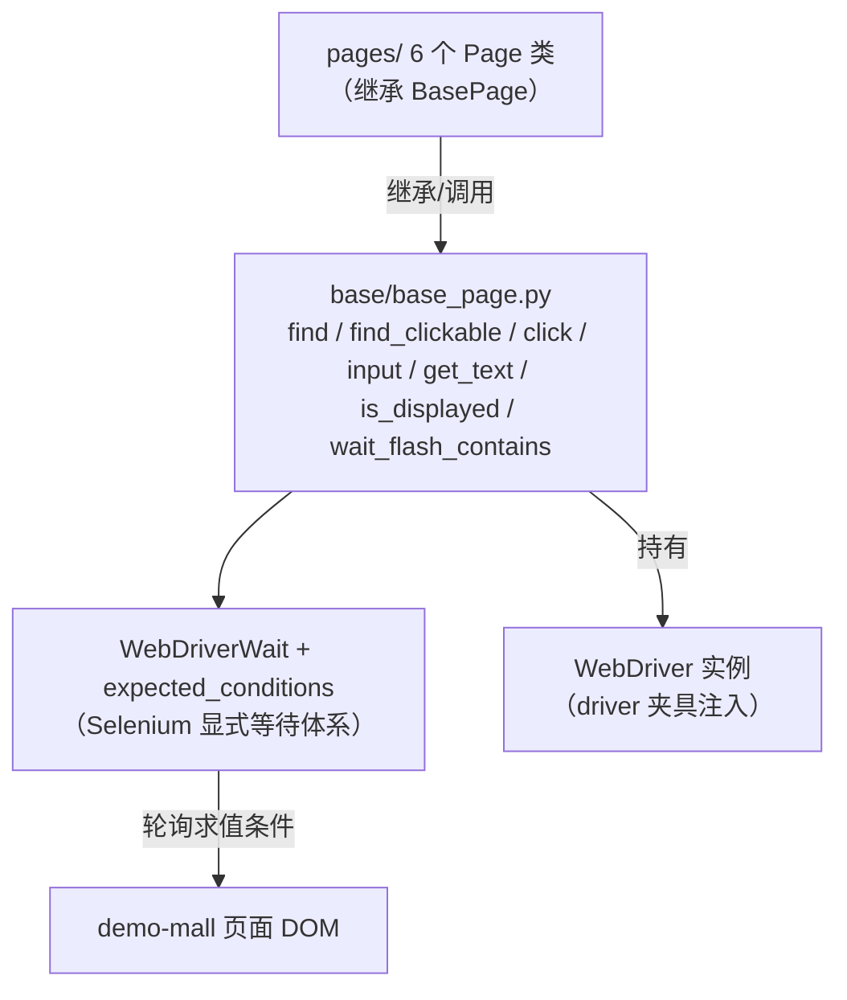

# BasePage封装与显式等待（ui-test-framework · 文档03）

> 一句话：解决 UI 自动化最大的稳定性难题——"脚本比页面快"——用统一的显式等待层让每个操作自带成功条件，全项目零 `time.sleep`。

## 1. 在整个框架中的位置

BasePage 是所有页面对象的父类，处于"基础层与页面对象层"的交界：向下持有 WebDriver，向上输出"能等、能点、能读"的操作原语。



依赖关系：
- Page 类只通过 BasePage 的方法触碰元素，**不直接碰 WebDriverWait**（等待策略只有一处可改）；
- flash 提示与导航栏定位器在 base.html 全站共享，也收在 BasePage。

## 2. 涉及文件

| 文件 | 职责 |
|---|---|
| `base/base_page.py` | `BasePage` 类：等待封装、基础操作、flash 同步、导航栏操作 |
| `common/config_loader.py` | 提供 timeout（显式等待全局超时）与 base_url |
| `selenium.webdriver.support.ui.WebDriverWait` / `expected_conditions` | Selenium 官方等待设施（理解对象，非本框架代码） |

## 3. 如何实现（逐方法讲解）

### 3.1 `__init__`：页面对象与 driver 的绑定

```python
class BasePage:
    def __init__(self, driver):
        self.driver = driver
        self.base_url = str(config["base_url"]).rstrip("/")
        self.timeout = int(config.get("timeout", 10))
        self.wait = WebDriverWait(self.driver, self.timeout)
```

每个 Page 实例持有：driver 引用、base_url（拼接 open 路径用）、超时、一个可复用的 WebDriverWait。**WebDriverWait(driver, timeout) 本身很轻**——它只是把"谁、等多久"存起来，真正干活的是 `until(条件函数)`。

### 3.2 显式等待的底层机制（必须懂到这个深度）

`WebDriverWait.until(method)` 的源码逻辑（简化）：

```python
def until(self, method, message=""):
    end_time = time.time() + self._timeout
    while True:
        try:
            value = method(self._driver)   # 每隔 poll_frequency(默认0.5s) 调一次条件
            if value:                      # 条件返回真值 -> 立刻返回，不等满 timeout
                return value
        except InvalidElementStateException / NoSuchElementException:
            pass                           # 这两类"还没准备好"的异常 -> 吞掉继续轮询
        time.sleep(self._poll)             # 注意：sleep 在 Selenium 内部，不是我们的代码
        if time.time() > end_time:
            raise TimeoutException(message)
```

三个关键推论：
1. **条件是"轮询求值"**：`method(self._driver)` 每 0.5 秒重新执行一次，元素何时就绪何时返回，最坏等满 timeout 抛 `TimeoutException`；
2. **快而准**：元素 100ms 后就绪就 100ms 返回——显式等待"不慢"，慢的是 sleep；
3. **异常即失败**：条件函数抛出"非预期"异常（如 `StaleElementReferenceException`、`WebDriverException`）**不会**被吞掉重试，直接炸出去——写条件 lambda 时只做简单 DOM 查询就是安全的。

### 3.3 `find(locator)`：为什么条件是"可见"而不是"存在"

```python
def find(self, locator):
    return self.wait.until(EC.visibility_of_element_located(locator))
```

`presence_of_element_located` 只要元素在 DOM 树里就过；但 `display:none` 的元素也在 DOM 里，对它 click 会抛 `ElementNotInteractableException`。`visibility_of_element_located` = 存在 + 可见（非 display:none/visibility:hidden）+ 有尺寸，才是"能交互"的合理代理条件。

### 3.4 `find_clickable / click / input`

```python
def find_clickable(self, locator):
    return self.wait.until(EC.element_to_be_clickable(locator))

def click(self, locator):
    return self.find_clickable(locator).click()

def input(self, locator, text):
    element = self.find(locator)
    element.clear()               # 清残留：表单默认值/浏览器自动填充
    element.send_keys(str(text))
    return element
```

`element_to_be_clickable` = 可见 **且** enabled。按钮还没绑完事件、还在遮罩层下面时点击会被吞掉，等"可点击"能挡掉这类 flaky。

### 3.5 `find_all` 与 `is_displayed`：读快照与判存在

```python
def find_all(self, locator):
    # "此刻快照"：数行数、数按钮用裸 find_elements，不等待
    return self.driver.find_elements(*locator)

def is_displayed(self, locator, timeout: int = 3) -> bool:
    try:
        WebDriverWait(self.driver, timeout).until(EC.visibility_of_element_located(locator))
        return True
    except TimeoutException:
        return False
```

- **什么时候用快照**：读取"当前有多少行"这类断言输入。行数读取本身不该等待（等谁？），同步责任在前面的页面动作方法里；
- **is_displayed 的 timeout=3**：负向判断（"应该没有的东西"）失败路径不用陪跑满 10 秒全局超时，参数化短超时显著加快负向用例。

### 3.6 `wait_flash_contains`：全框架最精髓的同步方法

```python
def wait_flash_contains(self, expected: str, timeout: int = None) -> str:
    timeout = timeout or self.timeout
    WebDriverWait(self.driver, timeout).until(
        EC.text_to_be_present_in_element(FLASH_MESSAGE, expected)
    )
    actual = self.find(FLASH_MESSAGE).text
    return actual
```

为什么不能"点击后直接读 #flash"：点击"提交订单"后浏览器要 POST → 302 → 渲染新页面，这中间旧 DOM 还活着，读到的可能是**旧页面残留的上一条提示**。`text_to_be_present_in_element` 会一直轮询直到**期望文本真的出现**——旧提示不匹配就继续等，天然跨过新旧页面切换窗口。所有"点击后出现提示"的页面动作（加购/更新/删除/支付/取消）内部都调用它作为统一同步点，调用方拿到的必然是新页面。

### 3.7 `open`：拼接与导航

```python
def open(self, path: str):
    self.driver.get(f"{self.base_url}{path}")   # get 阻塞到页面 onload
    return self
```

`driver.get` 会阻塞到页面 `onload` 事件——服务端渲染的页面此时初始 HTML 已可用；JS 动态内容仍需显式等待（本项目无此问题，但习惯保持）。

## 4. 为什么这样设计（决策点 + 备选方案对比表）

| 决策 | 备选方案 | 对比结论 |
|---|---|---|
| 显式等待 | time.sleep(3) 固定等待 | sleep 等短了必挂、等长了极慢（22 条用例每处多等 3 秒就是灾难），且网络抖动照样挂；显式等待"条件就绪即返回"，快且稳 |
| 显式等待 | 隐式等待 implicitly_wait(10) | 隐式只管"找到元素"，不管"可点击/文本出现/元素消失"；全局隐性生效导致轮询叠加（显式 0.5s 轮询里的 find 又被隐式拖 10s），超时时间变得不可预测。本项目 `implicitly_wait(0)` 显式关闭 |
| find 用 visibility 条件 | presence 条件 | presence 会找到 display:none 的元素，点击时报 ElementNotInteractable；visibility 更接近"能交互" |
| 负向判断 is_displayed 返回 bool | 让 TimeoutException 直接抛 | 断言"提示出现了/按钮消失了"是正常业务分支不是异常，返回 bool 让用例代码读起来像陈述句；异常留给"框架级意外" |
| flash 同步用 text_to_be_present_in_element | 点击后 reload + 读文本 / 先等旧 flash 消失 | 后两者实现繁琐且仍有窗口期；按"期望文本出现"同步一行代码跨过所有窗口期 |
| timeout 全局 10s + 负向 3s | 到处写死数字 | 环境慢了（CI 机器弱）改一处配置全局生效；负向用例单独短超时兼顾速度 |

## 5. 怎么运行/验证

```bash
# 1) 验证"显式等待比 sleep 快"：读一个 1 秒内就绪的元素
cd /d/软件测试/ui-test-framework
UI_TEST_BASE_URL=http://127.0.0.1:5001 UI_TEST_HEADLESS=1 python -c "
import time
from selenium.webdriver.common.by import By
from common.driver_factory import create_driver
from base.base_page import BasePage
d = create_driver()
bp = BasePage(d)
bp.open('/login')
t0 = time.time()
bp.find((By.CSS_SELECTOR, '#btn-login'))
print('find 耗时 %.3f 秒（远小于 10s 全局超时 -> 条件就绪即返回）' % (time.time()-t0))
d.quit()
"
# 真实输出：
# 2026-10-25 05:33:50 [INFO] ui_test: 创建浏览器：browser=chrome headless=True
# 2026-10-25 05:33:51 [INFO] ui_test: 打开页面：http://127.0.0.1:5001/login
# find 耗时 0.013 秒（远小于 10s 全局超时 -> 条件就绪即返回）

# 2) 验证超时行为：找一个不存在的元素，应精确在 ~10s 抛 TimeoutException
UI_TEST_BASE_URL=http://127.0.0.1:5001 UI_TEST_HEADLESS=1 python -c "
import time
from selenium.webdriver.common.by import By
from selenium.common.exceptions import TimeoutException
from common.driver_factory import create_driver
from base.base_page import BasePage
d = create_driver(); bp = BasePage(d)
bp.open('/login')
t0 = time.time()
try:
    bp.find((By.ID, 'no-such-element'))
except TimeoutException as e:
    print('超时 %.1f 秒后抛 TimeoutException' % (time.time()-t0))
d.quit()
"
# 真实输出：
# 2026-10-25 05:33:53 [INFO] ui_test: 创建浏览器：browser=chrome headless=True
# 2026-10-25 05:33:54 [INFO] ui_test: 打开页面：http://127.0.0.1:5001/login
# 超时 10.2 秒后抛 TimeoutException

# 3) 全量用例（零 sleep 的直接证据：22 条 80 秒出头）
python -m pytest -v
# ======================== 22 passed in 79.44s (0:01:19) ========================
```

另可验证全项目无 sleep：`grep -rn "time.sleep" --include="*.py" .` —— 仅有两处命中，且都在**注释文字**里（base_page.py 的模块 docstring 和 conftest.py 的注释，内容正是解释"为什么禁用 sleep"），代码中没有任何一处 sleep 调用；唯一的 sleep 在 Selenium 库内部的轮询实现里。

## 6. 常见坑

1. **StaleElementReferenceException（元素过期）**：先 `rows = find_all(...)`，点击引发页面刷新后再 `rows[0].click()`——旧元素引用已失效。对策：需要操作时**重新查找**（本项目所有"行级操作"方法内部都现取现用，不缓存 WebElement）。
2. **条件函数里写复杂逻辑导致异常直抛**：`until(lambda d: d.find_element(...).text == x)` 在元素还没出现时抛 NoSuchElementException——它是被 WebDriverWait 吞掉重试的"预期异常"，安全；但 `d.find_element(...).text.strip().split()[0]` 在 text 为空时会抛 IndexError（非预期异常），直接炸出 until。对策：条件 lambda 只做"查询+比较"，加工逻辑放到条件满足之后。
3. **隐式+显式混用**：给 driver 设了 `implicitly_wait(10)` 又用 WebDriverWait，现象是"明明 1 秒就该超时却等了 10 秒"或轮询间隔诡异——显式等待内部每次 find 也吃隐式等待。本项目在工厂里 `implicitly_wait(0)` 一刀切。
4. **iframe 场景忘切**：元素明明在 HTML 里却 `NoSuchElementException`——它在 iframe 里。demo-mall 无 iframe，但这是通坑：先 `driver.switch_to.frame(...)`，用完 `switch_to.default_content()`。本框架暂未封装，遇到时在 BasePage 加 `switch_to_frame` 方法即可。
5. **把 is_displayed 当同步点**：`assert page.is_displayed(X)` 之前页面还在跳转，3 秒局部超时不够时误报"未显示"。同步点应该放在**动作方法**内部（如 wait_flash_contains），断言只消费已同步的状态。

## 7. 面试怎么讲

**30 秒版本**：
"BasePage 把等待策略收口：所有查找走 WebDriverWait + expected_conditions 显式等待，visibility 保证可交互、clickable 保证按钮真点了、text_to_be_present 处理 flash 的页面切换窗口。我理解 until 的底层是每 0.5 秒轮询求值条件函数、真值即返回、超时抛 TimeoutException，所以负向判断给 3 秒短超时、全项目禁 sleep——22 条用例 80 秒跑完，两次连跑全绿。"

**3 个高频追问及答法**：
1. *"显式等待和隐式等待到底差在哪？"* —— 隐式是 driver 级全局参数，作用于一切 find，只解决"存在性"；显式是语句级，可以表达"可点击/文本变化/元素消失"等任意条件，且"就绪即返回"。混用会让轮询叠加、超时不可预测，所以我显式把隐式等待置 0。
2. *"StaleElementReferenceException 怎么处理？"* —— 本质是 DOM 节点被替换后旧引用失效。预防优于处理：不缓存 WebElement（用完页面刷新就得重找）；必须重试时捕获后重新 locate 再操作。我会先看代码里哪里缓存了元素，而不是无脑 try-except。
3. *"为什么不封一个 auto_wait 装饰器让所有方法自动等待？"* —— 等待条件是"业务语义"（等什么状态），不是装饰器能猜的；过度封装会把显式等待退化成另一种"全局隐式"。正确做法是每个动作方法内部声明自己的同步条件——这就是 wait_flash_contains 存在的意义。

## 8. 复现任务清单

1. **写 BasePage 骨架**：`__init__` 绑 driver/timeout/base_url，持有 WebDriverWait。验收：实例化不报错。
2. **实现 find/find_clickable/click/input/get_text/get_attribute**：验收：临时脚本打开 /login 读到按钮文本"登 录"，input 后能登录成功。
3. **做第 5 节的两个计时实验**：验收：find 耗时 < 0.1s；不存在元素恰在 ~10s 抛 TimeoutException（把 timeout 改成 3 再试，应 ~3s）。
4. **实现 is_displayed / find_all**：验收：在商品页 `is_displayed((By.ID,'empty-result'))` 返回 False 且只花 ~3 秒。
5. **实现 wait_flash_contains**：验收：写一条失败登录用例，断言 flash 文本"用户名或密码错误"通过；把 flash 文本断言换成错误的期望词，确认它在 10 秒后超时而不是立刻假通过。
6. **grep 自查**：`grep -rn "time.sleep" --include="*.py" .` 只有注释命中（解释禁用原因的文字）。验收：能说出"唯一的 sleep 在 Selenium 轮询内部，我们的代码里一处都没有"。
7. **把 timeout=2 跑一遍全量**：故意把 config timeout 调小，观察哪类用例先挂（通常是网络往返最长的 e2e），体会全局超时的标定方法——然后改回 10，恢复全绿。
