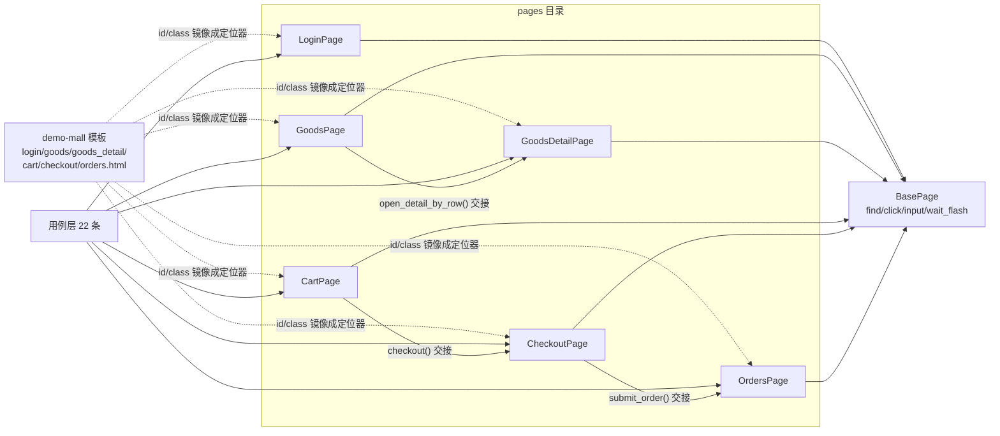

# 页面对象层与元素定位（ui-test-framework · 文档04）

> 一句话：解决"怎么把 HTML 变成代码对象"的问题——6 个 Page 类把每个页面的定位器与动作收敛成一处，定位器选型有明确优先级：id 优先、CSS 次之、XPath 不用。

## 1. 在整个框架中的位置

页面对象层夹在 BasePage（提供操作原语）和用例层（消费页面动作）之间，是"被测页面在代码里的镜像"。



页面间交接链与业务流一致：列表 → 详情 → 购物车 → 结算 → 订单，每个"交接方法"内部等待新页面就绪后返回下一个 Page 对象。

## 2. 涉及文件

| 文件 | 覆盖页面 | 关键能力 |
|---|---|---|
| `pages/login_page.py` | /login | 登录/失败提示/登出后导航判断 |
| `pages/goods_page.py` | /goods | 搜索（含同步陷阱处理）、行数据读取、行级加购、进详情 |
| `pages/goods_detail_page.py` | /goods/\<id\> | 名称/价格/库存读取、设数量、加购 |
| `pages/cart_page.py` | /cart | 行数/合计/小计、改数量、删除、去结算 |
| `pages/checkout_page.py` | /checkout | 应付金额、提交订单 |
| `pages/orders_page.py` | /orders | 订单行/状态（文本+class 双读）、支付、取消 |

## 3. 如何实现（逐文件/逐方法讲解）

### 3.1 定位器声明范式

每个 Page 类头部是"定位器清单"——类常量 + 选择理由注释：

```python
class LoginPage(BasePage):
    PATH = "/login"
    USERNAME_INPUT = (By.ID, "username")   # id 唯一且是后端专门为自动化埋的
    LOGIN_BUTTON  = (By.ID, "btn-login")
    FLASH = FLASH_MESSAGE                  # 从 BasePage 继承的全站共享定位器
```

没有 id 的元素退到 CSS 选择器，并**收窄作用范围**：

```python
class GoodsPage(BasePage):
    GOODS_ROWS = (By.CSS_SELECTOR, "#goods-table tr.goods-row")   # 先锚定表格 id 再匹配行 class
    ROW_NAME_LINK = (By.CSS_SELECTOR, "a.goods-name")              # 行内子元素
```

行操作的关键技巧——**把查找范围限定在行元素内**：

```python
def row_name(self, index: int) -> str:
    return self._row(index).find_element(*self.ROW_NAME_LINK).text

def add_to_cart_by_row(self, index: int):
    self._row(index).find_element(*self.ROW_ADD_CART).click()
    return self.wait_flash_contains("已加入购物车")   # 行级动作自带同步
```

`row.find_element(...)` 只在这一行 `<tr>` 的子树里找——既快，又绝不会错拿第 5 行的按钮。`_row(index)` 统一做越界保护，报错信息直接告诉你"索引越界，实际行数多少"。

### 3.2 搜索的同步陷阱（本项目真实踩过的坑）

`GoodsPage.search()` 的第一版同步条件是"搜索框的值等于关键词"——结果 `test_search_hit_one_row` 失败：**输入框在点击搜索之前就已经被我们填上了关键词**，旧页面直接让等待条件通过，读到旧页面的 10 行数据。修复：GET 表单提交后 URL 必然变成 `/goods?keyword=...`，用 URL 变化做同步：

```python
def search(self, keyword: str):
    self.input(self.SEARCH_INPUT, keyword)
    self.click(self.SEARCH_BUTTON)
    self.wait.until(lambda d: "keyword=" in d.current_url)   # URL 带查询串 = 新页面已到达
    return self
```

这个案例的教学价值：**同步条件必须是"只有新页面才可能满足"的状态**，任何"旧页面也满足"的条件都是假阳性。

### 3.3 flash 驱动的行级操作（cart/orders）

购物车与订单页的每个操作都是 form POST → 302 重回本页，操作方法内部等对应 flash 出现再返回：

```python
def update_quantity(self, index: int, quantity: int) -> str:
    row = self._row(index)
    qty_input = row.find_element(*self.ROW_QTY_INPUT)
    qty_input.clear()
    qty_input.send_keys(str(quantity))
    row.find_element(*self.ROW_UPDATE_BTN).click()
    return self.wait_flash_contains("数量已更新")     # 等到 = 新页面已渲染，后面读总价零竞态
```

调用方（用例）拿到的必然是新页面，直接断言 `cart.total() == "597.00"`，不需要自己写任何等待。

### 3.4 订单状态的双重读取

```python
def row_status(self, index: int) -> str:
    return self._row(index).find_element(*self.ROW_STATUS).text        # 'paid'

def row_status_class(self, index: int) -> str:
    return self._row(index).find_element(*self.ROW_STATUS).get_attribute("class")  # 'order-status status-paid'

def has_cancel_button(self, index: int) -> bool:
    # 存在性判断用 find_elements 取列表判长度：没有就返回 []，不抛异常
    return len(self._row(index).find_elements(*self.ROW_CANCEL_BTN)) > 0
```

文本断言业务含义（paid），class 断言前端渲染分支真的走到 paid 那条线——双保险。"按钮消失"是订单状态机规则（paid 不可取消）的 UI 表现，`find_elements` 判长度是存在性判断的标准写法（`find_element` 找不到会抛异常）。

### 3.5 页面交接与就绪标志

每个 Page 都有"就绪标志"方法（`wait_ready()` 或 open 系列里 find 表格/输入框）：

```python
# pages/checkout_page.py
def submit_order(self):
    self.click(self.SUBMIT_BUTTON)
    from pages.orders_page import OrdersPage    # 方法内延迟导入，避免循环依赖
    page = OrdersPage(self.driver)
    page.wait_ready()                           # 交接前等新页面就绪
    return page
```

就绪标志的选择原则：选"**新页面独有**、且代表数据已渲染"的元素——订单页用 `#orders-table`（空车时也渲染），登录页用 `#username`，详情页用 `#goods-detail`。

## 4. 为什么这样设计（决策点 + 备选方案对比表）

| 决策 | 备选方案 | 对比结论 |
|---|---|---|
| By.ID 优先 | 全用 XPath | id 是 HTML 规范唯一标识、浏览器原生 getElementById 最快、可读性最好；XPath 绝对路径脆（改个 div 层级就挂）、文本定位依赖文案（改个按钮字就挂） |
| 无 id 时用 CSS_SELECTOR | 无 id 时用 XPath | CSS 走浏览器原生 querySelector，速度与 id 同级；`#table tr.row` 这种"锚定+收窄"写法可读性强；XPath 唯一优势是"向上找父级"（本框架不需要） |
| 行级操作限定作用域 | 全页找第 N 个按钮 | `button.btn-add-cart` 全页有 10 个，`//button[3]` 靠 DOM 顺序猜；行内查找从"哪一行"出发，语义与业务一致且不会错行 |
| 动作方法内嵌 wait_flash_contains | 用例里自己等 flash | 同步条件与动作强绑定（加购等"已加入购物车"、支付等"支付成功"），散在用例里早晚会等错对象；PO 内聚后用例零等待代码 |
| 存在性判断 find_elements 判长度 | try/except 包 find_element | try/except 用异常做流程控制既慢（异常构造开销）又模糊（真异常和"没找到"分不清）；find_elements 返回空列表语义天然正确 |
| 页面路径 PATH 类常量 | open() 里写死完整 URL | base_url 变化只影响 config；PATH 让"这个类对应哪个页面"一眼可见，open_detail 这类动态路径单独拼 |

## 5. 怎么运行/验证

```bash
cd /d/软件测试/ui-test-framework

# 1) 页面对象层的单类冒烟：GoodsPage 读行数与行名
UI_TEST_BASE_URL=http://127.0.0.1:5001 UI_TEST_HEADLESS=1 python -c "
from common.driver_factory import create_driver
from pages.goods_page import GoodsPage
d = create_driver()
g = GoodsPage(d).open_goods_page()
print('行数 =', g.row_count(), '| 第1行 =', g.row_name(0), g.row_price(0), '| goods-id =', g.row_goods_id(0))
d.quit()
"
# 真实输出：
# 2026-10-25 05:35:37 [INFO] ui_test: 创建浏览器：browser=chrome headless=True
# 2026-10-25 05:35:37 [INFO] ui_test: 打开页面：http://127.0.0.1:5001/goods
# 行数 = 10 | 第1行 = 无线蓝牙耳机 199.00 | goods-id = 1

# 2) 定位器覆盖验证：跑商品模块全部用例
UI_TEST_BASE_URL=http://127.0.0.1:5001 UI_TEST_HEADLESS=1 python -m pytest testcases/test_goods.py -v
# 真实输出（节选）：
# testcases/test_goods.py::TestGoodsList::test_default_list_has_10_rows PASSED [ 16%]
# testcases/test_goods.py::TestGoodsList::test_search_hit_one_row PASSED   [ 33%]
# ...
# ======================== 6 passed in 23.35s ==============================

# 3) 全量（真实输出）
python -m pytest -v
# ======================== 22 passed in 79.44s (0:01:19) ========================
```

## 6. 常见坑

1. **搜完立刻读结果（同步假阳性）**：如 3.2 所述，等待条件在旧页面就能满足。通用对策：找"只有新页面才有的状态"——URL 变化、新元素出现、期望文本出现，三选一。
2. **列表页读错行**：用全页 `find_elements(By.CSS_SELECTOR, "a.goods-name")[3]` 与"第 3 行的商品名"不是一回事（一旦某行结构变化就错位）。对策：永远先取行（`tr.goods-row`），再在行内找子元素。
3. **表单按钮的 default submit 行为**：行内 `<form>` 里的按钮点击即提交整页跳转，点击后原来拿到的行元素全部失效（stale）。对策：需要连续操作多行时，**每行操作后重新获取行列表**（本项目 `add_to_cart_by_row` 连续调用两次，第二次内部重新 find_all）。
4. **改数量后合计没变就断言**：点击"更新"按钮后 POST 还在路上，读到的还是旧总价。对策：等 flash"数量已更新"（flash 只在新页面渲染出现），再读合计。
5. **动态 id 陷阱**：如果被测系统用前端框架生成随机 id（如 `id="btn-3f8a"`），By.ID 立刻失效。demo-mall 是服务端渲染 + 人工埋的稳定 id，没有此问题；遇到动态 id 系统时，改用 data-* 属性或语义 class 定位（`button.btn-add-cart[data-goods-id='1']`）。

## 7. 面试怎么讲

**30 秒版本**：
"页面对象层 6 个类对应 6 个页面，定位器一律 id 优先、CSS 次之、不用 XPath；行级操作把查找范围限定在行元素内防止错行；每个会引起跳转的动作方法内部用 flash 文本或 URL 变化做同步——比如搜索同步等 URL 出现 keyword 参数，因为输入框的值在旧页面就满足了，这个假阳性我真踩过并修掉。订单状态我用文本加样式类双断言，按钮存在性用 find_elements 判长度。"

**3 个高频追问及答法**：
1. *"为什么不用 XPath？它明明更灵活。"* —— 灵活的代价是脆弱：绝对路径随布局改动失效、文本定位随文案改动失效，而且比 CSS 慢。CSS 的"锚定+收窄"（#id tr.class）已经覆盖我的全部场景；XPath 的父级/兄弟轴本框架用不到。
2. *"怎么定位动态渲染的元素（前端框架场景）？"* —— 先找稳定的语义钩子：data-* 属性、表单 name、语义 class；都没有就和前端约定埋 test-id（真实项目最常见）；等待上从"页面 onload"换成"目标元素出现"（显式等待一样适用）。
3. *"Page 类越写越大怎么办？"* —— 三板斧：拆组件类（导航栏、筛选器、分页器各成一个类，被 Page 组合）、公共动作下沉 BasePage、读操作和操作分开命名。我的 BasePage 收编了全站导航栏与 flash，就是防各页重复的第一步。

## 8. 复现任务清单

1. **写 LoginPage**：定位器常量 + `open_login_page/login/flash_text_after_submit`。验收：单条登录成功用例通过（docs/05 会写这条用例）。
2. **写 GoodsPage 并单类冒烟**：验收：第 5 节脚本输出"行数 = 10 | 第1行 = 无线蓝牙耳机 199.00"。
3. **复刻搜索同步陷阱**：第一版故意用"输入框值=关键词"做同步，跑 `test_search_hit_one_row` 观察它随机失败；再改成 URL 同步修复。验收：能讲清"为什么旧页面会骗过等待条件"。
4. **写 GoodsDetailPage**：验收：能读出"无线蓝牙耳机 / 199.00 / 50"三件套，改数量加购后 flash 出现"已加入购物车"。
5. **写 CartPage**：重点实现 update_quantity/delete_item 的 flash 内嵌同步。验收：改数量后立刻读总价正确（连续跑 5 次不抖）。
6. **写 CheckoutPage + OrdersPage**：验收：e2e 用例（docs/05）通过；`row_status_class` 能返回 `status-paid`；`has_cancel_button` 在 paid 后返回 False。
7. **定位器审计**：`grep -rni "xpath" pages/ base/` 唯一命中是 login_page.py 注释里"为什么不用 XPath"的说明文字，没有任何 `By.XPATH` 定位器；`grep -rc "By.ID\|By.CSS_SELECTOR" pages/*.py` 确认全部定位器只用这两种。
