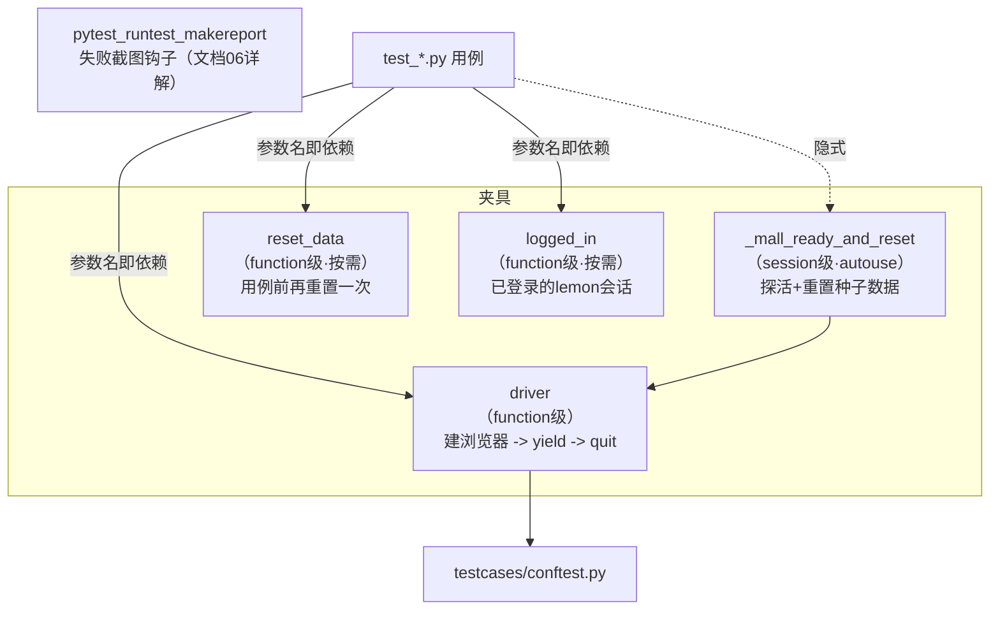

# 用例层conftest与fixture（ui-test-framework · 文档05）

> 一句话：解决"用例怎么拿到浏览器、怎么保证数据干净、公共前置怎么不重复写"的问题——用 pytest 夹具体系把用例里所有非业务的东西全部抽走，让每条用例只剩"操作序列 + 断言"。

## 1. 在整个框架中的位置

conftest.py 是用例层的地基：pytest 的夹具（fixture）解析机制会自动把它提供给同目录及子目录的用例，用例通过参数名"要"夹具即可。



夹具依赖与执行顺序（同一条用例挂多个夹具时）：`_mall_ready_and_reset`（会话级最先，整个进程一次）→ `driver` → `reset_data`/`logged_in`（按用例参数声明顺序）。

## 2. 涉及文件

| 文件 | 职责 |
|---|---|
| `testcases/conftest.py` | 全部夹具 + 失败截图钩子（钩子详见文档 06） |
| `testcases/test_login.py` | 7 条登录用例（含 YAML 数据驱动） |
| `testcases/test_goods.py` | 6 条商品用例 |
| `testcases/test_cart.py` | 4 条购物车用例（全部挂 reset_data） |
| `testcases/test_order.py` | 5 条订单用例（含 e2e 链路 + 模块级公共前置函数） |

## 3. 如何实现（逐夹具/逐用例讲解）

### 3.1 会话级数据 reset：可重复性的根

```python
@pytest.fixture(scope="session", autouse=True)
def _mall_ready_and_reset():
    probe = _http_session().get(f"{config['base_url']}/goods", timeout=15)
    probe.raise_for_status()
    reset_mall_data()
    yield
```

- `scope="session"`：整个 pytest 进程只执行一次；
- `autouse=True`：所有用例隐式依赖，**保证它一定发生在第一条用例之前**，用例文件里看不到引用但顺序有保证；
- 探活用带 `Retry` 的 requests 会话（backoff_factor 指数退避），服务没起会自动等，**项目代码零 sleep**。

`reset_mall_data()` 就是 POST `/api/test/reset`（带 `X-Test-Key: mall-test-key`）。为什么需要它：UI 用例会加购、下单、扣库存，**第 1 次跑和第 N 次跑结果一致**的唯一可靠办法是把世界还原成种子态，而不是指望用例自己收拾干净。

### 3.2 driver 夹具：function 级隔离

```python
@pytest.fixture()
def driver():
    d = create_driver()
    yield d        # <- 用例在此运行
    d.quit()       # <- 无论用例成败都执行
```

yield 之前的代码 = setup，之后 = teardown；即使用例失败，teardown 也必然执行——这是 pytest 相对"try/finally 手工管理"的核心优势。

### 3.3 reset_data：给"强数据假设"的用例

```python
@pytest.fixture()
def reset_data():
    reset_mall_data()
    yield
```

与会话级 reset 的分工：会话级管"**跨运行**可重复"，本夹具管"**会话内用例之间**互不污染"。购物车/订单用例对"购物车里有什么、有没有历史订单"有强假设，所以每条都挂；商品/登录用例不受脏数据影响，不挂（省时间）。

**一个必须知道的细节**：reset 后用户表被重建但 id 不变（种子确定性），所以"先登录、后 reset"的会话 cookie 依然有效。但本项目统一用 `def test_xxx(self, reset_data, logged_in)` 的参数顺序——**先 reset 再登录**，语义干净不依赖这个细节。

### 3.4 logged_in：消灭登录样板代码

```python
@pytest.fixture()
def logged_in(driver):
    users = load_yaml(config["users_file"])
    account = users["valid_accounts"][0]           # lemon
    page = LoginPage(driver)
    page.open_login_page()
    page.login_and_expect_success(account["username"], account["password"])
    return page
```

10 多条用例都需要"已登录状态"，这段 4 行的前置只写一次。夹具返回 **LoginPage 上下文对象**（而不是裸 driver），用例可以继续 `logged_in.open("/goods")` 或拿 `logged_in.driver` 交接其他 Page。

### 3.5 数据驱动用例：parametrize 吃 YAML

```python
@pytest.mark.parametrize(
    "case",
    load_yaml(config["users_file"])["invalid_accounts"],
    ids=lambda c: c["case_name"],       # 报告显示中文用例名而非 case0/case1
)
def test_login_failed_data_driven(self, driver, case):
    page = LoginPage(driver).open_login_page()
    page.login(case["username"], case["password"])
    actual_flash = page.flash_text_after_submit(case["expected_flash"])
    assert case["expected_flash"] in actual_flash
    assert "/login" in driver.current_url
```

一条用例 × N 组数据 = N 条报告记录（密码错误/用户不存在/空用户名）。新增失败场景只需在 users.yaml 加一行，代码零改动。

### 3.6 模块级公共前置：订单链路复用

`test_order.py` 里支付/取消/终态三条用例都要"先有一单"，抽成模块级函数（不是夹具，因为返回值要参与断言且参数就是夹具）：

```python
def _create_pending_order(logged_in) -> OrdersPage:
    goods = GoodsPage(logged_in.driver).open_goods_page()
    goods.add_to_cart_by_row(0)
    goods.go_cart_by_nav()
    cart = CartPage(logged_in.driver)
    cart.find(CartPage.CART_TABLE)
    checkout = cart.checkout()
    orders = checkout.submit_order()
    orders.wait_flash_contains("下单成功")
    return orders
```

用例体因此只剩差异部分：`orders.pay(0)` / `orders.cancel(0)`。

### 3.7 用例的 AAA 结构（示例：e2e 下单）

```python
def test_e2e_create_order_pending(self, reset_data, logged_in):
    # Arrange：reset_data（干净世界）+ logged_in（已登录）
    goods = GoodsPage(logged_in.driver).open_goods_page()
    # Act：搜索 -> 详情 -> 加购 2 件 -> 结算 -> 提交
    goods.search("耳机")
    detail = goods.open_detail_by_row(0)
    detail.set_quantity(2).add_to_cart()
    ...
    orders = checkout.submit_order()
    # Assert：flash、行数、状态、单号
    assert orders.row_count() == 1
    assert orders.row_status(0) == "pending"
    assert orders.row_order_no(0).startswith("ORD")
```

一条用例一个业务问题；断言失败时输出信息直接回答"期望什么、实际什么"。

## 4. 为什么这样设计（决策点 + 备选方案对比表）

| 决策 | 备选方案 | 对比结论 |
|---|---|---|
| driver function 级（每用例新浏览器） | module/session 级共享 | 共享省 40% 时间但状态串台；一条用例失败可能连环污染后面 10 条，排查成本远超省下的时间 |
| 数据 reset 两级制（会话+用例级） | 只会话级 / 只用例级 / 用例自清理 | 只会话级：购物车用例互相污染；只用例级：登录类用例也陪跑 reset 浪费；自清理：清理代码本身会失败留下更脏的现场。两级按需最稳 |
| 夹具放 conftest.py | 放独立 fixtures.py 再 import | conftest 是 pytest 约定的自动发现机制，零 import；独立文件适合夹具量大时分层（本框架一个文件足够） |
| logged_in 返回 Page 上下文 | 返回裸 driver | 返回上下文让用例能无缝链到其他 Page（`logged_in.open(...)`、`logged_in.driver` 都可用）；裸 driver 丢掉了"已登录"这个语义 |
| 数据驱动用 YAML 而非 Excel/CSV | Excel(openpyxl)/CSV | YAML 支持中文、嵌套、注释，零额外依赖；Excel 要多装库且二进制没法 code review；CSV 嵌套表达不了 |
| ids 用中文 case_name | 默认 case0/case1 | Allure 报告里"密码错误"比 case1 直观得多；参数化用例的报告可读性是数据驱动的门面 |
| 公共前置用模块函数而非夹具 | 也做成夹具 | 夹具适合"无返回值的环境准备"；这里返回值（订单页对象）是断言对象且参数化不灵活，普通函数更直白 |

## 5. 怎么运行/验证

```bash
cd /d/软件测试/ui-test-framework

# 1) 登录模块单独跑（真实输出，注意数据驱动的三条中文用例名）
UI_TEST_BASE_URL=http://127.0.0.1:5001 UI_TEST_HEADLESS=1 python -m pytest testcases/test_login.py -v
# 真实输出（节选）：
# testcases/test_login.py::TestLogin::test_login_success PASSED            [ 14%]
# testcases/test_login.py::TestLogin::test_login_failed_data_driven[\u5bc6\u7801\u9519\u8bef] PASSED [ 42%]
# ...
# ============================= 7 passed in 23.41s ==============================

# 2) 只跑冒烟集（smoke 标记生效验证）
UI_TEST_BASE_URL=http://127.0.0.1:5001 UI_TEST_HEADLESS=1 python -m pytest -m smoke -v
# 真实输出（节选）：
# collecting ... collected 22 items / 18 deselected / 4 selected
# testcases/test_cart.py::TestCart::test_cart_rows_and_total PASSED        [ 25%]
# ...
# ====================== 4 passed, 18 deselected in 15.04s ======================

# 3) 全量两次（真实输出）
python -m pytest -v
# ======================== 22 passed in 79.44s (0:01:19) ========================
python -m pytest -v
# ======================== 22 passed in 78.17s (0:01:18) ========================
```

夹具执行顺序验证：给 `_mall_ready_and_reset`、`driver`、`reset_data` 各加一行 `logger.info` 跑一条购物车用例，日志顺序应为：探活/reset（一次）→ 建浏览器 → reset_data → 用例体 → 退浏览器。

## 6. 常见坑

1. **夹具参数顺序颠倒导致"登录后又被 reset"**：`def test_x(self, logged_in, reset_data)` 的写法下若 pytest 先实例化 logged_in 再执行 reset_data，登录态虽然因 id 不变仍有效，但语义已经乱了。对策：按依赖顺序声明参数（reset 在前），并理解"夹具实例化顺序 = 参数声明顺序（同作用域时）"。
2. **在用例之间传递可变状态**：用模块级 dict 在用例间传"上一条用例创建的订单号"，一旦并行化或单独重跑某条用例立刻崩。对策：每条用例自建前置（`_create_pending_order`），无状态可依赖。
3. **session 级夹具里的 yield 忘了写 teardown 边界**：`yield` 之后的代码只在**整个会话结束**时执行，有人在里面做"每用例清理"——完全不生效。记牢：session 夹具的 teardown 一辈子一次。
4. **conftest 放错层级**：夹具要给 `testcases/` 用就必须放 `testcases/conftest.py`（或其上层目录）；放在 `pages/conftest.py` 用例层看不到。pytest 的查找规则是"从用例文件向上到 rootdir 逐层收集 conftest"。
5. **parametrize 的 ids 含中文乱码**：Windows 终端显示 `\u5bc6\u7801\u9519\u8bef` 是编码显示问题（报告里是正常中文）。若终端要正常显示，设置 `PYTHONIOENCODING=utf-8`；Allure 报告不受影响。

## 7. 面试怎么讲

**30 秒版本**：
"用例层基础设施全在 conftest：会话级 autouse 夹具开跑前调被测系统的 reset 接口保证数据确定性；function 级 driver 夹具每用例一个新浏览器，yield 后 quit 保证隔离；需要干净数据的购物车/订单用例再加一级 reset_data 夹具；十多条用例共用的'已登录状态'抽成 logged_in 夹具。数据驱动用 parametrize 直接吃 YAML，3 组失败登录数据一条用例代码搞定，报告里显示中文名。"

**3 个高频追问及答法**：
1. *"fixture 的 scope 怎么选？"* —— 按"状态的生命周期"选：浏览器会话属于用例 → function；数据种子属于整个运行 → session。原则是 scope 越大越危险（共享状态越多），能用 function 就不用 session，autouse 只给"所有用例都必须"的前置（数据 reset）。
2. *"夹具之间能互相依赖吗？"* —— 能，把夹具名写进另一个夹具的参数即可，pytest 自动按依赖图实例化。我的 logged_in 就依赖 driver；但要警惕依赖链过长（A→B→C→D），超过 2 层说明抽象有问题，应该合并或拆用例。
3. *"怎么保证两条用例互不影响？"* —— 三道防线：每用例新浏览器（会话隔离）→ 强数据假设用例加 reset_data（数据隔离）→ 用例内前置数据自己造（不依赖外部状态）。实测连续两次全量 22 条全绿就是验证手段。

## 8. 复现任务清单

1. **写 conftest 基础三件套**：`_mall_ready_and_reset` + `driver` + `reset_data`。验收：写一条临时用例参数里要 driver 和 reset_data，日志顺序正确（浏览器创建 → reset → 用例 → quit）。
2. **实现 _http_session 的 Retry 探活**：验收：故意先不起 mall 再跑 pytest，看到 requests 退避重试后以清晰错误失败（而不是一堆 Timeout 堆栈）。
3. **写 logged_in 夹具**：验收：`pytest testcases/test_login.py::TestLogin::test_login_success` 通过，且用例里没有任何登录代码。
4. **写 test_login.py 全部 7 条**：验收：`7 passed in ~23s`（真实数据），报告里有 3 条中文数据驱动用例。
5. **写 test_goods.py 6 条**：验收：`6 passed in ~23s`（真实数据）。
6. **写 test_cart.py 4 条（挂 reset_data）**：验收：单独连跑两次本文件都 4 passed——证明每条用例自带干净数据。
7. **写 test_order.py 5 条（抽 _create_pending_order）**：验收：全量 `pytest -v` 22 passed；`pytest -m smoke` 收集 4 条。
8. **隔离性压力测试**：`pytest testcases/test_cart.py::TestCart::test_empty_cart_shows_empty_tip` 单跑（此时购物车里有前面用例加购的残留吗？不存在——它自己 reset 了）→ 通过，验证"任何子集都可独立重跑"。
