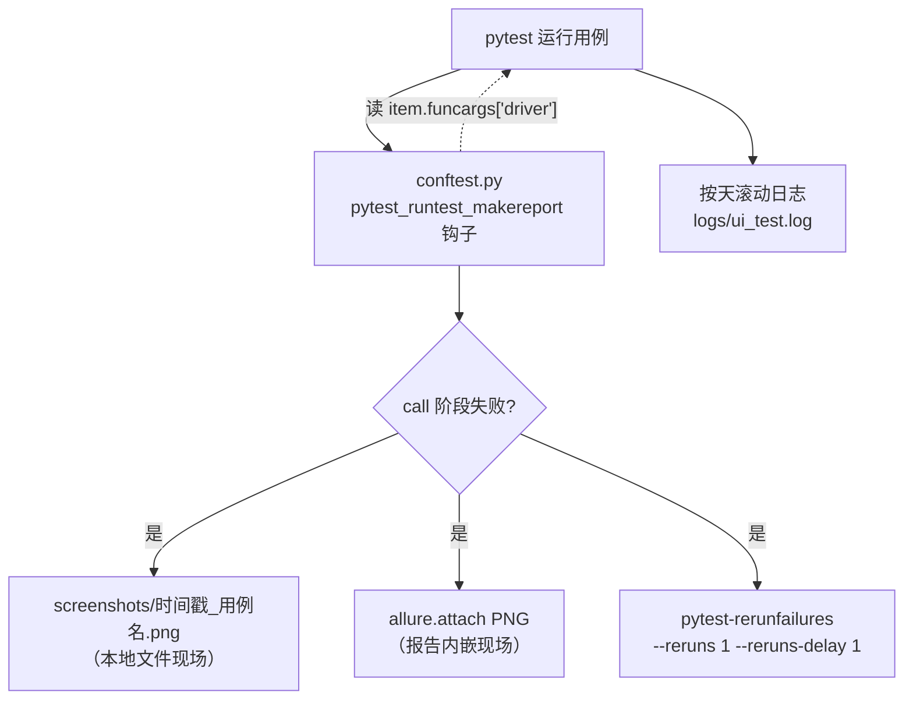

# 失败截图与稳定性工程（ui-test-framework · 文档06）

> 一句话：解决"用例失败后现场全丢、偶发失败反复出现"的问题——失败自动截图双落点（本地文件 + Allure 附件）、失败自动重跑过滤环境抖动，把"事后排障"变成"打开报告看现场"。

## 1. 在整个框架中的位置

本模块是框架的"质量保险"：不参与业务逻辑，但决定每次失败你能多快定位、每次偶发抖动会不会误报。



三道防线的关系：**钩子留现场**（失败必留证据）→ **重跑抗抖动**（环境级偶发不误报）→ **显式等待消灭根因**（文档 03，真正的治本）。

## 2. 涉及文件

| 文件 | 职责 |
|---|---|
| `testcases/conftest.py` 的 `pytest_runtest_makereport` | 失败判定、保存截图、attach 进 Allure |
| `pytest.ini` 的 `--reruns 1 --reruns-delay 1` | 失败自动重跑策略 |
| `common/logger.py` | 全程 INFO 日志，失败时 pytest 把捕获日志随报告输出 |
| `screenshots/` | 截图产物目录（gitignore，留 .gitkeep） |

## 3. 如何实现（逐段讲解）

### 3.1 makereport 钩子的机制

```python
@pytest.hookimpl(hookwrapper=True, tryfirst=True)
def pytest_runtest_makereport(item, call):
    outcome = yield
    report = outcome.get_result()

    if report.when != "call" or not report.failed:
        return

    web_driver = item.funcargs.get("driver") if hasattr(item, "funcargs") else None
    if web_driver is None:
        return
    ...
```

逐段拆解（这是面试最容易问深的点）：
- **hookwrapper=True**：让本函数"包裹"原始 hook——`yield` 之前的代码在原始 hook 执行**前**跑，之后在后跑；`outcome.get_result()` 拿到的就是 pytest 生成的 `TestReport` 对象；
- **report.when 的三个值**：`setup`（夹具阶段）/ `call`（测试函数体）/ `teardown`（清理阶段）。只拦 `call`：夹具失败（环境问题）与用例失败（产品问题）性质不同，分开对待；
- **item.funcargs**：该用例实际用到的所有夹具实例的字典。截图必须在这里拿 driver——因为钩子触发的时刻，`driver` 夹具的 teardown（quit）**还没执行**，浏览器还活着；等 teardown 里再想拍就晚了；
- **防御**：纯 requests 用例没有 driver 参数，直接 return，钩子绝不能成为新的失败源。

### 3.2 截图与双落点

```python
    timestamp = time.strftime("%Y%m%d-%H%M%S")
    # nodeid 形如 testcases/test_login.py::TestLogin::test_xxx，压成安全文件名
    safe_name = re.sub(r'[\\/:*?"<>|\s]+', "_", item.nodeid.replace("::", "__"))
    screenshot_path = SCREENSHOT_DIR / f"{timestamp}__{safe_name}.png"

    try:
        SCREENSHOT_DIR.mkdir(exist_ok=True)
        web_driver.save_screenshot(str(screenshot_path))
        allure.attach(
            web_driver.get_screenshot_as_png(),
            name=f"失败截图-{item.name}",
            attachment_type=allure.attachment_type.PNG,
        )
        logger.error("用例失败，已保存截图：%s", screenshot_path)
    except Exception as exc:
        logger.error("生成失败截图时出错：%s", exc)
```

- **文件名三要素**：时间戳（同用例多次失败不覆盖）、nodeid（一眼知道哪条用例）、非法字符清洗（Windows 文件名不允许 `\/:*?"<>|`）；
- **双落点**：`save_screenshot` 留本地文件（报告没生成/被清也能看），`allure.attach` 把 PNG 塞进报告（不用离开浏览器就能看现场）；
- **整段 try/except**：截图属于"锦上添花"，它自己挂了（浏览器已崩等）只记日志，绝不让排障工具反过来污染测试结果。

### 3.3 失败重跑策略

```ini
addopts = --alluredir=reports/allure-results --clean-alluredir --reruns 1 --reruns-delay 1
```

pytest-rerunfailures 的工作方式：用例失败后**在原进程内重新执行一次**（Allure 报告里显示为带 rerun 标记的两条记录）。重跑通过 → 这条用例按 passed 计，但报告保留 rerun 痕迹，可统计"不稳定用例率"。

重跑的价值与边界：环境级抖动（网络一次超时、Chrome 偶发慢加载）大多能过；**逻辑性失败（元素改版、断言错误）重跑一万次也过不了**——所以重跑是救生圈不是遮羞布，rerun 率升高本身就是需要分析的信号。

### 3.4 真实验证记录（本项目实际发生）

开发过程中 `test_search_hit_one_row` 因同步假阳性失败，钩子产生了完整现场链路：

```
FAILED testcases/test_goods.py::TestGoodsList::test_search_hit_one_row - asse...
2026-10-25 05:21:24 [ERROR] ui_test: 用例失败，已保存截图：
    D:\软件测试\ui-test-framework\screenshots\20261025-052124__testcases_test_goods.py__TestGoodsList__test_search_hit_one_row.png
============== 1 failed, 21 passed, 1 rerun in 82.75s (0:01:22) ===============
```

对这条截图目视检查（旧页面 10 行商品列表），一眼定位到"搜索同步条件在旧页面就能满足"。**这正是截图的价值：把"读日志猜"变成"看图确认"。** 我还用一个临时故意失败的用例验证了 Allure 附件落点：

```
用例: test_intentional_fail | status: failed | attachments:
    [('失败截图-test_intentional_fail', '...-attachment.png'), ('log', '...'), ('stdout', '...')]
```

报告 JSON 里 attachments 数组确有 PNG，验证后临时用例已删除。

## 4. 为什么这样设计（决策点 + 备选方案对比表）

| 决策 | 备选方案 | 对比结论 |
|---|---|---|
| makereport 钩子截图 | 每条用例末尾 try/except 截图 / teardown 夹具截图 | try/except 侵入每条用例且 teardown 阶段 driver 可能已 quit；钩子是 pytest 官方扩展点，零侵入、时机精确（teardown 前） |
| 只在 call 阶段失败截图 | setup/teardown 失败也截 | setup 失败是环境问题（截图无意义，driver 可能都没建出来）；call 失败才是产品缺陷现场。边界清晰 |
| 本地文件 + Allure 附件双落点 | 只 attach 进报告 | 报告可能被 --clean 清掉或没来得及 generate；本地文件是最终兜底，成本几行代码 |
| --reruns 1（只重跑一次） | 重跑 3 次以上 | 重跑越多，"不稳定用例"越容易被粉饰成稳定；1 次足以过滤纯环境抖动，真不稳定要修不要藏 |
| --clean-alluredir 每次清空 | 结果累积 | 累积的旧结果会把"这次修复了没"搅浑；连续集成场景应由 CI 归档历史而不是本地堆积 |
| 失败信息同时进日志 | 只靠 pytest 输出 | pytest 输出在终端一闪而过；logs/ui_test.log 按天滚动留存，与截图互相印证 |

## 5. 怎么运行/验证

```bash
cd /d/软件测试/ui-test-framework

# 1) 正常运行：无失败 → screenshots/ 应为空（只有 .gitkeep）
python -m pytest -v
# ======================== 22 passed in 79.44s (0:01:19) ========================
ls screenshots/
# .gitkeep

# 2) 验证截图链路：临时造一条必败用例（验证完删除！）
cat > testcases/test_zz_fail_demo.py << 'EOF'
import allure
@allure.feature("临时验证")
def test_intentional_fail(driver):
    driver.get("http://127.0.0.1:5001/login")
    assert 1 == 2, "故意失败：验证失败截图钩子"
EOF
python -m pytest testcases/test_zz_fail_demo.py
# 真实输出：
# ========================= 1 failed, 1 rerun in 6.55s ==========================

# 3) 检查三个落点
ls screenshots/ | tail -2
# 20261025-052546__testcases_test_zz_fail_demo.py__test_intentional_fail.png   <- 本地文件
python -c "
import json, glob
for f in glob.glob('reports/allure-results/*-result.json'):
    d = json.load(open(f, encoding='utf-8'))
    if d['name'] == 'test_intentional_fail':
        print([a['name'] for a in d.get('attachments', [])])
        break
"
# 真实输出：['失败截图-test_intentional_fail', 'log', 'stdout']   <- 报告附件

# 4) 清理：删除临时用例与验证截图，再全量跑一次恢复全绿
rm testcases/test_zz_fail_demo.py screenshots/*.png
```

## 6. 常见坑

1. **截图时机太晚拿到黑图/报错**：在 driver 夹具的 teardown 里截图——此时 quit 已执行，报 `MaxRetryError` 或拍到"窗口已关闭"。对策：截图必须发生在钩子（teardown 前）。
2. **Allure 附件没出现在报告里**：钩子里 attach 忘了带 `attachment_type=allure.attachment_type.PNG`，报告里显示为乱码文本文件；或者用了 `allure.attach.file(path)` 却在报告 generate 前删了源文件。本项目用二进制直 attach（不落临时文件），规避后者。
3. **把 reruns 当万能药**：定位器写错也配 `--reruns 3`，全量跑一次 10 分钟、全靠重跑撑绿——报告里 rerun 标记满屏飞。正确姿势：rerun 只过滤环境抖动，逻辑失败必须修代码。
4. **nodeid 直接当文件名在 Windows 报错**：`::`、`\`、`/` 都是 Windows 文件名非法字符，`save_screenshot` 直接 OSError。必须正则清洗（见 3.2）。
5. **钩子函数签名写错静默失效**：`pytest_runtest_makereport` 拼错或参数不是 `(item, call)`，pytest 不报错但钩子不生效——表现为"失败但永远没有截图"。验证方法就是第 5 节的"故意失败"用例，写完钩子必须实测一次。
6. **stale 元素截图**：失败原因是 StaleElementReferenceException 时，浏览器停在旧页面，截图仍有价值但要看清"这是哪个页面"——建议同时 attach `driver.current_url`，一行代码信息量翻倍（可自行扩展）。

## 7. 面试怎么讲

**30 秒版本**：
"稳定性工程我做了三层：第一层治本，全项目显式等待消灭时序抖动；第二层拦截，pytest_runtest_makereport 钩子在 call 阶段失败、driver teardown 之前自动截图，双落点——本地时间戳文件名和 Allure 报告附件；第三层兜底，--reruns 1 过滤环境级偶发。我真实踩过搜索同步假阳性的失败，就是靠截图一眼定位的，这条链路我用故意失败的用例完整验证过。"

**3 个高频追问及答法**：
1. *"为什么截图要写在 makereport 钩子里，不能写在用例 finally 里？"* —— finally 侵入每条用例（22 条抄 22 遍），而且 teardown 里 driver 可能已 quit；钩子是 pytest 官方扩展点，触发时机在 teardown 之前、浏览器必然存活，对用例完全零侵入。
2. *"UI 自动化 flaky 怎么治理？"* —— 分因施治：时序类用显式等待治本（我的 wait_flash_contains 模式）；环境类靠重跑过滤但要监控 rerun 率；数据类靠 reset 接口把世界还原；剩下的真不稳定用例单独标注分析，不允许"多跑几次总能过"。
3. *"失败后除了截图你还能留下什么现场？"* —— 三件套：截图（画面）、current_url + page_source（结构）、pytest 捕获的日志（过程）。Allure 里 log/stdout 默认就有，page_source 可以在钩子里一并 attach，三样凑齐基本不用复现。

## 8. 复现任务清单

1. **写 logger**：验收：跑任何一条用例后 `logs/ui_test.log` 存在且含"创建浏览器"记录。
2. **写 makereport 钩子**：验收：造一条故意失败的临时用例，`screenshots/` 出现 `时间戳__...png`，Allure 结果 JSON 的 attachments 里有 PNG（完整命令见第 5 节）。
3. **验证"teardown 前"时机**：在钩子里打印 `web_driver.session_id`，确认非 None（浏览器还活着）。验收：能解释"为什么 teardown 里截不了图"。
4. **配置 reruns**：pytest.ini 加 `--reruns 1 --reruns-delay 1`。验收：故意失败用例的输出是 `1 failed, 1 rerun` 而不是 `1 failed`。
5. **体验截图排障全流程**：故意改坏 GoodsPage 的一个定位器 → 跑 → 打开截图看到"实际页面长什么样" → 修回来 → 确认全绿且 screenshots 清空。
6. **建立"无失败即无产物"的洁癖**：确认最终全绿后 screenshots/ 只剩 .gitkeep、allure-results 里没有 failed 记录。验收：`python -c "import json,glob; print(sum(1 for f in glob.glob('reports/allure-results/*-result.json') if json.load(open(f,encoding='utf-8'))['status']!='passed'))"` 输出 0。
